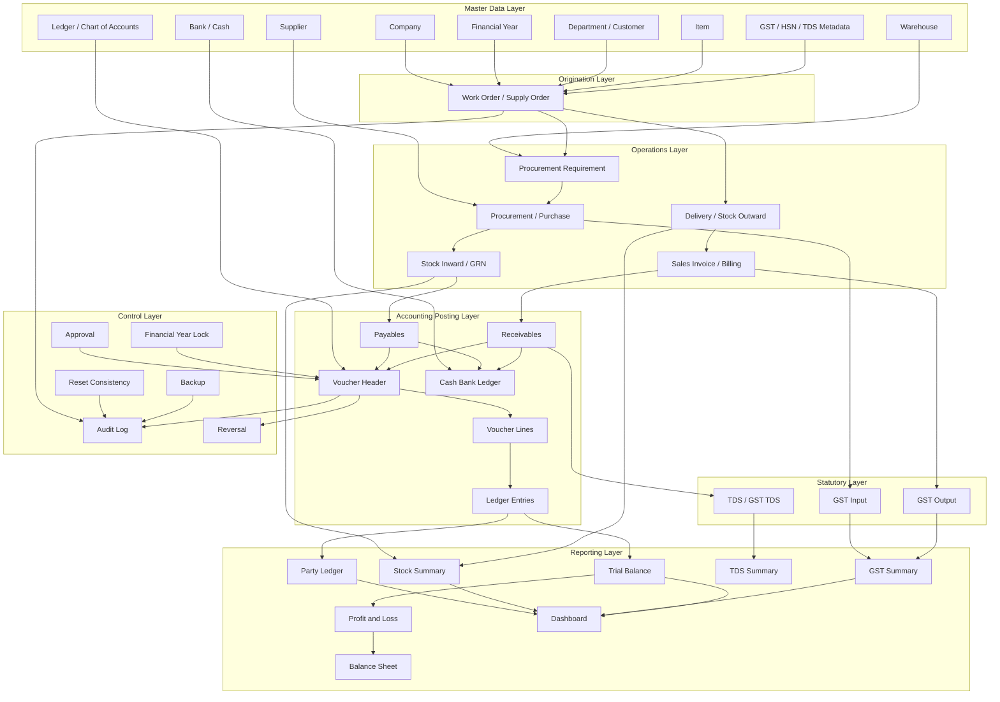

# Work Order Rooted Business Voucher Flow Chain

Date: 2026-07-09

Mode: Documentation audit only. No feature implementation, App.jsx refactor, accounting logic change, database schema change, posting logic change, or git commit was performed.

## A. Executive Summary

In the GII government supply business, the commercial flow starts from the department's Work Order, Supply Order or Government Purchase Order. The current codebase implements this root mainly as **Supply Order**, not as a separate `work_orders` table or Work Order voucher type.

The actual business chain should be read as:

Work Order / Supply Order -> procurement planning -> supplier procurement / purchase -> stock inward -> supplier payable -> input GST / TDS where applicable -> department billing / invoice -> stock outward / delivery -> receivable -> output GST -> receipt from department -> bank/cash ledger -> supplier payment -> final margin/profitability -> Trial Balance -> Profit and Loss -> Balance Sheet -> dashboard -> audit trail.

Business voucher/document means the operational source document or transaction that users understand commercially: Supply Order, procurement, purchase bill, invoice, receipt, payment, expense, stock inward/outward, CRAC, document attachment.

Accounting voucher means the debit-credit accounting record created after posting: Sales, Purchase, Receipt, Payment, Journal, Contra, Debit Note, Credit Note, Reversal. Accounting vouchers generate `voucher_lines`, then `ledger_entries`, and those ledger entries feed statutory and financial reports.

Audit result:

**PARTIAL / GAP / RISK**

Supply Order exists and is heavily linked downstream, so the ERP has a source-document root. However, the Voucher Dashboard does not show Work Order / Supply Order as the first business-flow node. It starts from guided business voucher buttons such as Receipt, Supplier Payment, Sales, Purchase and Expense. That is primarily a UI/dashboard concept gap, not proof that the data model is missing the order root.

## B. Work Order / Supply Order Origin Analysis

| Question | Finding |
|---|---|
| Is Work Order present by name? | Partially. "Work Order" appears as document/checklist wording, especially under Order Documents and Document Center. No separate `work_orders` table was found. |
| Is Supply Order serving the same role? | Yes. `supply_orders` is the operational root table for orders. |
| Which table stores it? | `supply_orders`, with item lines in `order_items`. Source: `src/main/database/init.js:406`, `src/main/database/init.js:2040`. |
| Which renderer screen creates/shows it? | The `supply_orders` transaction view in `App.jsx`, using `SupplyOrderEntryForm`, `SupplyOrderItemsGrid`, and `SupplyOrderRecordsPanel`. Source: `src/renderer/App.jsx:3110`, `src/renderer/App.jsx:3305`, `src/renderer/features/operations/supplyOrders/`. |
| Which IPC/service handles it? | Generic `records:create`, `records:update`, `records:list` invoke `createRecord`, `updateRecord`, `listRecords`; `createRecord` routes `supply_orders` through `createSupplyOrderRecord`. Source: `src/main/main.js:777`, `src/main/main.js:778`, `src/main/database/init.js:2898`, `src/main/database/init.js:2939`. |
| Which downstream modules refer to its id? | `procurements`, `expense_entries`, `invoices`, `payments`, `order_items`, `procurement_items`, `invoice_items`, `receivables`, `payment_allocations`, stock inward/outward/returns, goods receipts, delivery challans, CRAC and documents. |
| Does it appear in Voucher Dashboard? | No, not as a root button/card. Voucher Dashboard shows guided voucher workflows. Source: `src/renderer/App.jsx:4122`, `src/renderer/App.jsx:4530`, `src/renderer/App.jsx:4540`. |
| Does it appear in executive/operations/accounts dashboard? | Yes in main dashboard/order widgets and operations dashboard. Dashboard config has Orders Pending/Orders Received/Total Orders pointing to `supply_orders`. Source: `src/renderer/features/dashboards/dashboardConfig.js:12`, `src/renderer/features/dashboards/dashboardConfig.js:26`, `src/renderer/features/dashboards/dashboardConfig.js:57`. |
| Does it appear in profitability or order pipeline reports? | Yes. `orderProfitability` and `buildOperationsData` resolve chains by order. Source: `src/main/database/init.js:4934`, `src/renderer/features/operations/operationsIntelligence.js:638`. |
| Is current naming business-correct for GII? | Partially. Supply Order is valid, but government users may expect Work Order / Department Purchase Order as alternate business labels. |

Classification:

- **PARTIAL:** Supply Order exists and acts as root.
- **GAP:** Work Order/Supply Order is not shown as root in Voucher Dashboard.
- **RISK:** Voucher Dashboard visually starts from accounting/guided voucher actions, which can mislead users into thinking invoices/payments/vouchers are the business origin.

## C. Master Data Dependency Layer

| Master | Why Required | Vouchers/Docs Depending On It | What Breaks If Missing | Table | Screen/Service |
|---|---|---|---|---|---|
| Company | Company context controls all records and reports. | All transaction, accounting and document flows. | Wrong company posting or blocked save. | `companies` | Masters > Companies, `records:*` IPC |
| Financial Year | Date control, lock, opening/closing. | Vouchers, opening balances, financial reports. | Locked-year posting failure, report mismatch. | `financial_years` | Financial Control screens |
| Government Department / Customer | Buyer and receivable party. | Supply Order, Invoice, Receipt, Receivables. | No order/invoice customer ownership. | `government_departments` | Masters > Departments |
| Supplier | Vendor and payable party. | Procurement, Purchase Voucher, Supplier Payment. | Purchase/payable cannot be linked. | `suppliers` | Masters > Suppliers |
| Item | Goods/services sold/procured. | Order Items, Procurement Items, Invoice Items, Stock. | No quantity, HSN, inventory or valuation basis. | `items` | Masters > Items |
| Unit | Quantity interpretation. | Order/procurement/invoice/stock lines. | Quantity reports become unclear. | item `unit` field | Items master/import |
| HSN/SAC | GST classification. | Order, purchase, invoice, GST reports. | GST calculation/report risk. | item `hsn_code`, line HSN fields | Items and line forms |
| GST Rate | Input/output tax basis. | Purchase, Sales, GST Summary/Register. | GST register mismatch. | item/line `gst_rate`, invoice `gst_type` | Item master, invoice/voucher forms |
| TDS Section | Deduction classification. | Receipt allocation, TDS reports. | TDS recovery lacks statutory classification. | TDS fields/party allocation structures | Receivables/allocations |
| Warehouse / Location | Stock custody. | Stock inward/outward, GRN, delivery. | Stock cannot be posted or valued correctly. | `warehouses` | Masters > Warehouses |
| Bank / Cash Account | Treasury ledger. | Receipts, payments, contra, cash/bank ledger. | No bank/cash posting trail. | `banks`, `cash_bank_ledger` | Masters > Banks, voucher screens |
| Chart of Accounts / Ledgers | Debit-credit posting target. | All accounting vouchers and reports. | Voucher posting cannot create correct ledger entries. | `accounts` | Chart of Accounts, quick create |
| Employee / User | Order owner, maker/checker, audit. | Supply Order, approvals, audit log. | Ownership and approval traceability weak. | `employees`, `users` | Masters > Employees, auth |
| Expense Head | Cost classification. | Expense Voucher, profitability. | Expenses cannot be classified. | `expense_heads` | Masters > Expense Heads |
| Credit Terms | Due date/ageing basis. | Receivables/payables ageing. | Ageing and due-date reports unreliable. | `credit_terms` | Receivables & Payables controls |
| Approval Settings | Maker-checker control. | Posting-sensitive records. | Bypass risk or stuck drafts. | `approval_queue`, status fields | Approval Queue |

## D. Correct Business Flow for GII Government Supply Work

1. Company selected.
2. Financial year selected.
3. Department/customer master created.
4. Supplier master created.
5. Item master created.
6. HSN/GST/Unit/warehouse configured.
7. Work Order / Supply Order received from department.
8. Work Order / Supply Order entered into ERP.
9. Required items and quantities captured.
10. Expected billing value and delivery terms recorded.
11. Procurement requirement generated against Work Order / Supply Order.
12. Supplier selected.
13. Procurement / purchase recorded.
14. Stock inward recorded.
15. Supplier payable created.
16. Input GST captured if applicable.
17. TDS liability captured if applicable.
18. Goods supplied to department.
19. Stock outward / delivery recorded.
20. Sales invoice / billing raised against Work Order / Supply Order.
21. Output GST recorded.
22. Department receivable created.
23. Receipt received from department.
24. Receipt voucher posted.
25. Bank/cash ledger updated.
26. Supplier payment made.
27. Payment voucher posted.
28. Payable reduced.
29. Profitability calculated.
30. GST/TDS reports updated.
31. Trial Balance updated.
32. Profit & Loss updated.
33. Balance Sheet updated.
34. Dashboard cards updated.
35. Audit log records critical actions.
36. Reversal, reset and financial-year lock controls protect data.

## E. Business Voucher Types Found In Code

| Type | Purpose | Required Masters | Parent | Child Documents / Tables | Source Screen/Service | Accounting Impact | Inventory Impact | GST/TDS Impact | Receivable/Payable/Cash Impact | Audit/Reports |
|---|---|---|---|---|---|---|---|---|---|---|
| Work Order | Business term and document evidence. | Company, Department, Items. | Root concept. | `documents` linked to `supply_orders`. | Document Center. | None by itself. | None. | Metadata only. | None. | Document reports. |
| Supply Order | Root operational order. | Company, FY, Department, Employee, Items, GST metadata. | Root. | `order_items`, procurement, invoice, stock, documents. | `supply_orders` view, `createSupplyOrderRecord`. | None until downstream posting. | Demand/reservation planning. | Expected GST metadata. | Pipeline control. | Dashboard, operations, profitability. |
| Procurement Requirement | Shortage/planning queue. | Supply Order, Item, Warehouse. | Supply Order. | Procurement. | Inventory data/operations intelligence. | None until purchase posted. | Demand/planning. | None or expected input. | None. | Procurement queue. |
| Procurement / Purchase Bill | Supplier purchase record. | Supply Order, Supplier, Item, GST, Warehouse. | Supply Order. | `procurements`, `procurement_items`, stock inward, payables. | Operations/Procurement, guided purchase voucher. | Purchase voucher, payable, input GST. | Stock inward when posted. | Input GST. | Payable. | Purchase, payable, GST, P&L/BS. |
| Sales / Billing / Invoice | Department billing. | Supply Order, Department, Item, GST. | Supply Order. | `invoices`, `invoice_items`, `receivables`. | Billing Voucher screen, `saveBillingVoucher`, `postSalesVoucher`. | Sales voucher, receivable, output GST. | May require stock issue/COGS. | Output GST, TDS/GST TDS on receipt. | Receivable. | GST, receivable, P&L/BS. |
| Receipt | Department collection. | Invoice/receivable, Department, Bank/Cash. | Invoice/Supply Order. | `payments`, `payment_allocations`, cash bank. | Payments/Receipt allocation/guided receipt. | Receipt voucher. | None. | TDS/GST TDS deductions. | Cash/bank debit, receivable reduction. | Cash/bank, receivable, TDS. |
| Supplier Payment | Vendor settlement. | Supplier, purchase bill/payable, Bank/Cash. | Procurement/payable. | `supplier_payments`, supplier allocations. | Guided supplier payment/allocation. | Payment voucher. | None. | TDS if configured. | Payable reduction, cash/bank credit. | Payable, bank book. |
| Expense | Order cost booking. | Supply Order, Expense Head, Supplier/party, Bank if paid. | Supply Order. | `expense_entries`, voucher. | Expense entry/guided expense. | Expense accrual/payment voucher. | None. | As applicable. | Payable/cash if paid. | Profitability, P&L. |
| Inventory Inward | Stock receipt. | Procurement, Item, Warehouse, Supplier. | Procurement/Supply Order. | `stock_inwards`, `stock_ledger`, goods receipt. | Inventory post inward. | Usually purchase/stock accounting if posted. | Increases stock. | Purchase GST upstream. | None direct. | Stock summary/valuation. |
| Inventory Outward / Delivery | Issue to department. | Supply Order, Item, Warehouse. | Supply Order/Delivery Challan. | `stock_outwards`, `delivery_challans`, `stock_ledger`. | Delivery challan/stock outward. | COGS journal if automated. | Decreases stock. | None direct. | None direct. | Stock ledger, COGS. |
| Inventory Adjustment | Correct stock. | Item, Warehouse, approval. | Control transaction. | `stock_adjustments`, `stock_ledger`. | Inventory adjustment. | May affect COGS/adjustment ledger depending posting. | Increase/decrease stock. | None direct. | None. | Stock audit. |
| Return | Supplier/department return. | Item, Warehouse, order/supplier/department. | Supply Order/procurement. | `stock_returns`, `stock_ledger`. | Stock return. | May require credit/debit note separately. | Stock movement. | Separate note if financial. | Separate note if financial. | Stock, exception reports. |
| Bank Reconciliation | Match bank rows to ERP records. | Bank, vouchers, invoices, parties. | Bank statement import. | Bank statement entries, voucher proposals. | Bank Statement Import/Reconciliation. | Can propose or post vouchers. | None. | As per voucher. | Cash/bank reconciliation. | Bank reports, proposal audit. |
| Voucher Proposal | Controlled bank-to-voucher draft. | Bank row, party/ledger mapping. | Bank import. | `voucher_proposals`, draft/posted vouchers. | Voucher proposal queue. | Draft/post accounting voucher. | None. | As per type. | Cash/bank. | Proposal audit. |
| Manual Accounting Voucher | Accountant journal. | Ledgers, FY, approval. | Accountant decision. | `vouchers`, `voucher_lines`, `ledger_entries`. | Advanced Journal Entry. | Direct ledger impact. | None unless linked separately. | Manual tax risk if used. | Possible cash/bank if account used. | Trial Balance/P&L/BS. |
| Journal | General accounting adjustment. | Ledgers, FY. | Manual/automated source. | Voucher and ledger rows. | Manual/automated posting. | Direct. | Maybe COGS/stock adjustment. | As entered. | Maybe. | Financial statements. |
| Contra | Cash/bank transfer. | Bank/cash ledgers. | Treasury action. | Voucher/cash bank ledger. | Guided contra/manual. | Debit/credit bank/cash. | None. | None. | Cash/bank movement. | Cash/Bank Book. |
| Debit Note / Credit Note | Supplier/customer adjustment. | Party, invoice/purchase, GST. | Invoice/purchase. | Guided voucher/accounting voucher. | Voucher Dashboard. | Adjust receivable/payable and GST. | Usually none. | GST adjustment. | Party balance changes. | GST/party ledgers. |
| Opening Balance | Controlled opening entry. | Company, FY, ledgers/parties. | Opening migration. | Opening voucher, opening balance records. | Opening Balances. | Opening journal. | No live stock unless separate inventory opening. | Usually none. | Opening balances. | Trial Balance/BS. |
| Reversal Voucher | Audit correction. | Posted voucher, reason. | Original voucher. | Reversal voucher/ledger entries. | Voucher Register/Reversal route. | Equal-and-opposite posting. | Does not automatically undo all operational stock unless implemented. | Reverses accounting lines. | Reverses ledger effect. | Audit log. |

## F. Dependency Matrix

| Business Step | Parent / Origin | Depends On | Creates / Updates | Accounting Impact | Inventory Impact | GST/TDS Impact | Reports Affected | Code Location | Status |
|---|---|---|---|---|---|---|---|---|---|
| Work Order / Supply Order | Root business document | Company, FY, Department, Employee, Items, GST metadata, delivery terms | `supply_orders`, `order_items`, documents | Usually none until posting downstream | Demand/reservation planning | Expected tax metadata only | Order pipeline, dashboard, profitability | `src/main/database/init.js:406`, `src/renderer/App.jsx:3305` | Confirmed as Supply Order; Work Order naming partial |
| Procurement Requirement | Supply Order | Item, warehouse, stock availability | Reservation/requirement rows | None | Procurement planning | None | Procurement queue | `src/main/database/init.js:5487`, `src/renderer/features/operations/operationsIntelligence.js:638` | Confirmed |
| Procurement / Purchase | Supply Order | Supplier, item, GST, warehouse | `procurements`, `procurement_items`, stock inward/payable when posted | Purchase voucher, payable, input GST | Stock inward | Input GST | Purchase register, payables, GST, P&L/BS | `src/main/database/init.js:423`, `src/main/database/init.js:6360` | Confirmed |
| Stock Inward / GRN | Procurement/Supply Order | Procurement, supplier, item, warehouse | `stock_inwards`, `stock_ledger`, `goods_receipts` | Can be linked to purchase posting | Increases stock | Input GST upstream | Stock ledger, GRN, valuation | `src/main/database/init.js:1061`, `src/main/database/init.js:1539` | Confirmed |
| Supplier Payable | Procurement | Purchase bill, supplier | Payable reporting from procurement/supplier payment allocations | Purchase credit/payable | None | Input GST | Payables, supplier ledger | `src/main/database/init.js:2172`, `src/main/database/init.js:8316` | Partial; payable table named `supplier_payments` for payments, procurement drives payable |
| Supplier Payment | Payable/procurement | Supplier, bank/cash, purchase bill | `supplier_payments`, allocations, voucher | Payment voucher | None | TDS if configured | Bank book, payable ageing | `src/main/database/init.js:6794`, `src/main/database/init.js:6502` | Confirmed |
| Delivery / Stock Outward | Supply Order | Item, warehouse, order | `stock_outwards`, `delivery_challans`, stock ledger | COGS voucher in operational flow | Decreases stock | None direct | Stock issue vs billing, COGS | `src/main/database/init.js:1095`, `src/main/database/init.js:1587`, `scripts/verify-operational-flow.js:134` | Confirmed |
| Sales Invoice / Billing | Supply Order | Department, item, GST, stock/delivery | `invoices`, `invoice_items`, `receivables` | Sales voucher, receivable, output GST | May rely on stock issue | Output GST | Receivables, GST, TB, P&L, BS | `src/main/database/init.js:456`, `src/main/database/init.js:4808`, `src/main/database/init.js:6324` | Confirmed |
| Receipt | Invoice/receivable | Department, bank/cash, invoice | `payments`, allocations, cash/bank | Receipt voucher | None | TDS/GST TDS deductions | Cash/bank, receivables, TDS | `src/main/database/init.js:476`, `src/main/database/init.js:6393` | Confirmed |
| Expense | Supply Order | Expense head, party, bank if paid | `expense_entries`, voucher | Expense accrual/payment | None | Possible tax fields not fully certified | Profitability, P&L | `src/main/database/init.js:441`, `src/main/database/init.js:6817` | Confirmed |
| Accounting Voucher | Business document or manual entry | Ledgers, FY, approval | `vouchers`, `voucher_lines`, `ledger_entries` | Source of accounting truth | None directly except inventory-driven journals | GST/TDS through lines/register | TB/P&L/BS, ledgers | `src/main/database/init.js:1967`, `src/main/database/init.js:5813` | Confirmed |
| Audit / Controls | All critical actions | User, permissions, status | `audit_log`, approval fields, lock fields | Prevents unsafe posting/editing | Prevents unsafe stock actions | Supports statutory audit | Audit log, health center | `src/main/database/init.js:2208`, `src/main/database/init.js:6025` | Partial; route-level bypass risks need certification |

## G. Mermaid Flow Chart

## H. Voucher Dashboard Gap Audit

1. Voucher Dashboard renderer: `BusinessVoucherScreen` in `src/renderer/App.jsx:4120`.
2. Current cards/buttons shown:
   - Business Vouchers: Receipt, Supplier Payment, Sales, Purchase, Expense, Work Incentive, Employee Incentive, Contra, Credit Note, Debit Note.
   - Accounting Vouchers: Advanced Journal Entry, GST Adjustment, Opening Balance Voucher, Year End Voucher, Reversal Voucher.
   Source: `src/renderer/App.jsx:4122`, `src/renderer/App.jsx:4134`, `src/renderer/App.jsx:4540`, `src/renderer/App.jsx:4553`.
3. Work Order / Supply Order shown? No.
4. Why not shown?
   - Route exists: `supply_orders`.
   - Data source exists: `supply_orders`.
   - Card missing in Voucher Dashboard.
   - Naming mismatch: Work Order is document terminology; Supply Order is actual table/screen.
   - It is treated as Operations > Orders, not as a voucher-dashboard root.
5. Should it be shown as Business Voucher root, Operational Voucher, Order Management, Origination Document or separate Work Order Pipeline?
   - Recommended label: **Origination Document**.
   - Recommended dashboard area: **Origination Documents** with Work Order / Supply Order and Department Purchase Order.
6. Exact UI recommendation without implementing:
   - Split Voucher Dashboard into sections:
     1. Origination Documents: Work Order / Supply Order, Department Purchase Order, Opening Balance.
     2. Procurement & Inventory: Procurement Requirement, Purchase / Supplier Bill, Stock Inward, Stock Outward, Inventory Adjustment, Return.
     3. Sales & Receivables: Sales Invoice / Billing, Receipt, Credit Note, Debit Note.
     4. Payments & Payables: Supplier Payment, Expense, TDS Payment if applicable.
     5. Accounting Vouchers: Journal, Contra, Manual Voucher, Reversal Voucher.
     6. Controls: Approval Queue, Voucher Proposal, Bank Reconciliation, Audit Trail.

Gap status: **UI/dashboard gap and business-flow concept gap**, not a missing root table.

## I. Accounting Chain Explanation

A business document records the operational event. A Work Order / Supply Order records the commercial obligation but should not necessarily debit or credit accounts. It becomes the parent commercial file for procurement, delivery, billing, documents, collection and profitability.

Posting is the controlled conversion of a business document's accounting impact into debit-credit records.

The accounting voucher is the posted accounting header: voucher type, date, number, narration and source reference. Voucher lines are debit and credit rows. Ledger entries are the final accounting source of truth for Trial Balance, Profit & Loss and Balance Sheet.

Subsidiary ledgers/registers include receivables, payables, cash_bank_ledger, GST input/output, TDS and stock_ledger.

Rules:

- Work Order / Supply Order should be the commercial root.
- Work Order itself should not necessarily create accounting entries.
- Purchase/procurement creates payable, purchase/input GST and possibly stock impact when posted.
- Sales invoice creates receivable, sales and output GST when posted.
- Receipt/payment updates cash/bank and party balances.
- Ledger entries remain accounting source of truth.
- Stock ledger remains inventory source of truth.
- Cash bank ledger remains treasury source of truth.

## J. Who Depends On What

Work Order / Supply Order depends on:

- Company
- Financial Year
- Department/customer
- Items
- Quantity
- Delivery terms
- GST/HSN metadata
- Approval/user permissions

Work Order / Supply Order creates or controls:

- order pipeline
- procurement requirement
- delivery obligation
- billing reference
- profitability tracking
- document attachment chain
- dashboard pipeline

Purchase / Procurement depends on:

- Work Order / Supply Order where linked
- Supplier
- Item
- Warehouse
- GST rate
- Purchase ledger
- Payable ledger

Sales Invoice depends on:

- Work Order / Supply Order
- Department/customer
- Item
- GST rate
- Stock/delivery status if inventory-linked
- Sales ledger
- Receivable ledger

Receipt depends on:

- Invoice / receivable
- Department/customer
- Bank/cash account
- Financial year

Payment depends on:

- Supplier bill / payable / expense
- Supplier
- Bank/cash account
- Financial year

Inventory movement depends on:

- Item
- Warehouse
- Work Order / Procurement / Invoice source where applicable

Manual Accounting Voucher depends on:

- Ledger accounts
- Financial year
- approval/posting controls

Bank Reconciliation depends on:

- Bank account
- Imported statement rows
- Existing vouchers, invoices, parties and orders
- Maker/checker approval

Voucher Proposal depends on:

- Bank statement row
- Suggested party/ledger mapping
- Approval before draft/posting

Document upload depends on:

- Company
- Linked module
- Linked record
- File path/hash

## K. Report And Dashboard Dependency Chain

| Report / Dashboard | Source Table/Service | Upstream Business Document | Should Work Order / Supply Order Be In Chain? | Reset / Soft Delete Boundary | Status |
|---|---|---|---|---|---|
| Trial Balance | `accountingData`, `ledger_entries` | Posted vouchers from invoice/purchase/payment/manual | Indirect only through source refs | `ledger_entries`, `vouchers`, `is_deleted` | Confirmed |
| Profit & Loss | `accountingData`, ledger accounts | Posted purchase/sales/expense/COGS | Indirect; order profitability direct | `ledger_entries` | Confirmed |
| Balance Sheet | `accountingData`, ledger accounts | Receivable/payable/cash postings | Indirect | `ledger_entries`, `receivables`, payables | Confirmed |
| Receivables | `receivables`, invoice posting/allocation | Invoice linked to `supply_orders` | Yes | `receivables.is_deleted` | Confirmed |
| Payables | procurement/supplier payment allocation | Procurement linked to `supply_orders` | Yes | procurement/payment deletion and posting lock | Partial |
| Party Ledger | ledger/drilldown services | Vouchers from invoice/purchase/payment | Yes as reference | ledger/voucher soft delete | Partial |
| Cash Ledger | `cash_bank_ledger` | Receipt/payment/contra | Indirect through invoice/payment/order | cash bank soft delete | Confirmed |
| Bank Ledger | `cash_bank_ledger`, banks | Receipt/payment/contra/import | Indirect | cash bank + bank imports | Confirmed |
| GST Summary | voucher lines/GST fields | Purchase and invoice | Yes via purchase/invoice order link | vouchers/voucher_lines | Confirmed |
| TDS Summary | receivable allocations/deduction fields | Invoice/receipt | Yes via order/invoice | allocation soft delete | Partial |
| Stock Summary | `stock_ledger` | Procurement/delivery linked to order | Yes | `stock_ledger.is_deleted` | Confirmed |
| Inventory Valuation | stock ledger and item cost | Procurement/stock movements | Yes where order-linked | stock ledger | Confirmed |
| Order Pipeline | `buildOperationsData` | Supply Order | Root | `supply_orders.is_deleted` | Confirmed |
| Procurement Requirement | inventory reservation/requirements | Supply Order | Root | order/items/stock | Confirmed |
| Work Order Profitability | `orderProfitability` | Supply Order | Root | order/invoice/procurement/stock | Confirmed as Supply Order |
| Executive Dashboard | dashboard counts/config | Supply Orders, invoices, payments, stock | Yes | data service filters | Confirmed |
| Operations Dashboard | `OperationsScreen`, `operationsIntelligence` | Supply Order | Root | operations filters | Confirmed |
| Accounts Dashboard / Voucher Dashboard | `BusinessVoucherScreen` | Guided vouchers/accounting | Should show order root but does not | guided vouchers/vouchers | Gap |

## L. Controls And Safety Chain

Controls found:

- Permission guard around IPC handlers: `guarded(...)` in `src/main/main.js:601` onward.
- Approval queue and maker-checker functions: `submitForApproval`, `approveTransaction`.
- Financial year and posting locks: financial-year functions and locked-year verification.
- Reversal workflow: `reverseVoucher`.
- Soft delete and `is_deleted` fields across operational/accounting tables.
- Reset consistency service includes ordered deletion/dependency checks.
- Audit log table and audit service exist.
- Verification scripts cover accounting, financials, controls, operational flow and knowledge.

Control concerns:

- Supply Order has downstream lock protection and `posting_status` migration logic, but its role as root is not visually certified in Voucher Dashboard.
- Downstream vouchers can be manually created in Voucher Dashboard with order selection/manual order reference; this is useful but can bypass a strict "must start from existing order" mental model if not governed by UX.
- Some controls are verified by scripts; dashboard source certification remains a separate governance phase.

## M. Gap Findings

| Gap | Evidence | Risk | Recommended Next Action |
|---|---|---|---|
| Work Order/Supply Order missing from Voucher Dashboard | `BusinessVoucherScreen` buttons omit `supply_orders`; navigation has it under Operations. | Users may start from invoice/payment instead of order. | Add Origination Documents section in a future UI phase. |
| Naming mismatch | Table/screen says Supply Order; document checklist says Work Order. | Business confusion for government Work Order terminology. | Standardize labels as "Work Order / Supply Order" in documentation and dashboard. |
| Voucher Dashboard starts from accounting/guided voucher actions | Current selected workflow is Receipt/Supplier Payment/Sales/Purchase etc. | Visual flow implies accounting voucher is starting point. | Reframe dashboard into operational root -> posting chain. |
| Procurement/invoice/payment can be selected with order, but dashboard does not force order-first journey | Order options exist inside voucher form. | Manual order reference can reduce traceability if overused. | Certification phase should test order linkage requirements. |
| Document Center links Work Order as document type, not root entity | `DocumentsScreen.jsx:8` maps supply_orders docs including Work Order. | Work Order may look like attachment only. | Treat Work Order/Supply Order as root object plus document evidence. |
| Report source certification incomplete for dashboard root | Dashboard config has order cards, but Voucher Dashboard lacks root. | Dashboards may tell different stories. | Dashboard Source Certification. |
| App.jsx still owns large workflow orchestration | `BusinessVoucherScreen` and transaction screen logic reside in App.jsx. | Future changes risk App.jsx growth. | Later modularization only after lock/certification. |

## N. Recommended Next Phase

Recommended next phase:

**Work Order / Supply Order Dashboard Root Node Implementation**

Classification:

This should be treated as an **urgent business-flow correction** at the UI/dashboard level. It is not currently a deep accounting/data-model issue because `supply_orders` already functions as the root operational table and downstream records reference it. The correction should make the root visible and guide users from origination to downstream vouchers.

Do not start AIR/BRAIN/KG expansion until source-truth certification and dashboard source certification are complete.

## O. Safe Verification

Safe commands required for this documentation audit:

- `npm.cmd run lint:syntax`: PASS
- `npm.cmd run build`: PASS, with existing Vite large chunk warning
- `npm.cmd run verify:accounting`: PASS
- `npm.cmd run verify:financials`: PASS
- `npm.cmd run verify:controls`: PASS, 12 passed / 0 failed
- `npm.cmd run verify:knowledge`: PASS, 167 entries / 0 errors / 0 warnings

## P. Final Terminal Summary

To be filled after verification:

- Files inspected: source schema, renderer routes, voucher dashboard, operations intelligence, services, preload/API, verification scripts.
- Work Order/Supply Order status: Supply Order confirmed as root; Work Order appears as document/naming layer.
- Voucher types found: Supply Order, Procurement, Purchase, Sales/Billing, Receipt, Supplier Payment, Expense, Stock Inward/Outward/Adjustment/Return, Bank Reconciliation, Voucher Proposal, Manual Voucher, Journal, Contra, Debit Note, Credit Note, Opening Balance, Reversal.
- Dashboard gap status: Voucher Dashboard root card/section missing.
- Dependency chain mapped: Yes.
- Mermaid flowchart created: Yes.
- Verification result: PASS for lint, build, accounting, financials, controls and knowledge.
- Major gaps: UI/dashboard root visibility, naming consistency, dashboard source certification.
- Recommended next action: Work Order / Supply Order Dashboard Root Node Implementation.
