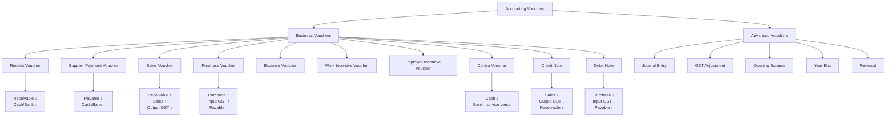

# GII GeM ERP — Complete User Operations Manual

**Version:** 0.1.0-internal-test  
**Build Branch:** phase-16-enterprise-crm-integration  
**Last Commit:** 78b799f  
**Platform:** Windows (Electron + React + SQLite)  
**Document Version:** 1.0  
**Last Updated:** 2026-07-14  

---

## Document Control

| Item | Value |
|------|-------|
| Document Title | GII GeM ERP Complete User Operations Manual |
| Document ID | GEM-UM-001 |
| Version | 1.0 |
| Target Application | GII GeM ERP v0.1.0-internal-test |
| Platform | Windows Desktop (Electron) + Browser Preview |
| Document Author | GI-EGS Engineering Governance |
| Approval Status | Internal Draft |
| Change Authority | Architecture Gate via GI-EGS Governance |

### Revision History

| Version | Date | Author | Description |
|---------|------|--------|-------------|
| 1.0 | 2026-07-14 | GI-EGS Governance | Complete operations manual covering all 18 functional domains |

---

## Table of Contents

1. [Introduction](#1-introduction)
2. [System Overview](#2-system-overview)
3. [Installation and Setup](#3-installation-and-setup)
4. [Quick Start Walkthrough](#4-quick-start-walkthrough)
5. [User Interface Guide](#5-user-interface-guide)
6. [Navigation and Shortcuts](#6-navigation-and-shortcuts)
7. [Master Data Management](#7-master-data-management)
8. [CRM Module](#8-crm-module)
9. [Sales Management](#9-sales-management)
10. [Purchase Management](#10-purchase-management)
11. [Inventory Management](#11-inventory-management)
12. [Manufacturing & Production](#12-manufacturing--production)
13. [Accounting & Finance](#13-accounting--finance)
14. [GST & Taxation](#14-gst--taxation)
15. [HR & Payroll](#15-hr--payroll)
16. [Reports & Dashboards](#16-reports--dashboards)
17. [Data Management](#17-data-management)
18. [System Administration](#18-system-administration)

---

## 1. Introduction

### 1.1 Purpose

This manual provides complete operational guidance for the GII GeM ERP system, an offline Windows desktop application purpose-built for Government e-Marketplace (GeM) supply chain management. It covers every functional domain from master data setup through accounting closure, including GST compliance, CRM, inventory, manufacturing, HR/payroll, and system administration.

### 1.2 Scope

The manual addresses all user-facing functions available in the v0.1.0-internal-test build (phase-16-enterprise-crm-integration, commit 78b799f). It is intended for:

- **Operations Managers** — day-to-day order, procurement, billing, and payment workflows
- **Accountants** — voucher entry, financial statements, GST returns, and period-end closing
- **Store/Inventory Keepers** — stock inward, outward, adjustments, and warehouse management
- **Administrators** — company setup, user management, backup/restore, system configuration
- **Government Supply Executives** — CRM, tenders, CRAC, and closure tracking

### 1.3 Application Profile

| Attribute | Value |
|-----------|-------|
| Name | GII GeM ERP |
| Architecture | Electron + React 19 + Vite 7 |
| Database | SQLite via better-sqlite3 |
| User Model | Single-user desktop; identity set in Settings > Company Info |
| Routing | View-state routing via App.jsx (no React Router) |
| Build Tool | Vite 7 |
| Packaging | electron-builder (NSIS installer, portable) |

### 1.4 Key Design Principles

- **Single-User Desktop**: No multi-user login; all operators share the same application instance
- **Local SQLite Database**: All data resides in a single file (`gii_gem_erp.db`) in the app's database folder
- **Double-Entry Accounting**: Every posted business transaction generates balanced debit/credit ledger entries
- **Company-Context Isolation**: All transactions are scoped by the currently selected company
- **Audit-First**: Every create, update, delete, post, reverse, and approval action is logged in the audit trail
- **Offline-First**: No internet dependency; GST returns and e-way bills are generated locally for manual GeM portal upload

---

## 2. System Overview

### 2.1 High-Level Architecture

GII GeM ERP follows a two-process Electron architecture:

```
┌─────────────────────────────────────────────────────────┐
│                   Electron Main Process                  │
│  (src/main/main.js)                                     │
│  ┌──────────────┐  ┌──────────────────┐  ┌────────────┐ │
│  │  init.js      │  │ accountingService│  │  services/  │ │
│  │ (DB schema,   │  │ (voucher posting,│  │ backup,     │ │
│  │  CRUD,        │  │  ledgers,        │  │ health,     │ │
│  │  reports)     │  │  financial stmts)│  │ feedback,   │ │
│  └──────────────┘  └──────────────────┘  │ verification│ │
│                                           └────────────┘ │
│  IPC Bridge (contextBridge → preload.cjs → renderer)      │
├─────────────────────────────────────────────────────────┤
│                Electron Renderer Process                  │
│  ┌─────────────────────────────────────────────────────┐ │
│  │  App.jsx (view-state routing, layout shell)          │ │
│  │  ┌──────────┐ ┌──────────┐ ┌───────────────────┐    │ │
│  │  │ features/│ │components│ │ config/           │    │ │
│  │  │ accounting│ │ layout   │ │ navigation.js,    │    │ │
│  │  │ inventory │ │ forms    │ │ viewDefinitions.js│    │ │
│  │  │ operations│ │ tables   │ │ storageKeys.js    │    │ │
│  │  │ billing   │ │ overlays │ │ importTemplates.js│    │ │
│  │  │ dashboards│ │ panels   │ └───────────────────┘    │ │
│  │  │ reports   │ └──────────┘                          │ │
│  │  │ importExp │                                        │ │
│  │  └──────────┘                                        │ │
│  └─────────────────────────────────────────────────────┘ │
└─────────────────────────────────────────────────────────┘
```

### 2.2 Modular Domains

The application is organized into the following feature domains:

| Domain | Feature Folder | Key Screens |
|--------|---------------|-------------|
| Masters | (App.jsx via MasterScreen) | Companies, Items, Customers, Suppliers, Employees, Warehouses, Banks, Expense Heads |
| CRM | CRM Module | Dashboard, Leads, Interaction Tracking, Communication Log |
| Sales | `features/billing` | Quotations, Orders, Invoices, Payment Collection, Credit Notes, Sales Returns, Delivery Challans |
| Purchase | `features/operations` | Purchase Orders, GRN, Purchase Invoices, Supplier Payments, Debit Notes, Purchase Returns, Inter-Branch Transfers |
| Inventory | `features/inventory` | Stock Dashboard, Movements, Adjustments, FIFO Valuation, Low Stock Alerts, Batch/Serial Tracking, Stock Counting |
| Manufacturing | (Production screens) | BOM, Production Orders, Material Issue, FG Receipt, Job Work, Costing |
| Accounting | `features/accounting` | Chart of Accounts, Journal/Contra/Payment/Receipt Vouchers, Ledger, Day Book, Trial Balance, P&L, Balance Sheet, Cash Flow, Funds Flow, Ratio Analysis, AR/AP Aging, Budgeting, TDS |
| GST & Tax | `features/accounting` | Configuration, Sales/Purchase Register, GSTR-1, GSTR-3B, E-way Bill |
| HR & Payroll | Masters + Reports | Employee Records, Attendance, Leave, Salary Structure, Payroll Processing, Payslip, Statutory PF/ESI/PT |
| Reporting | `features/reports` | Executive Dashboard, Sales/Purchase/Inventory/Accounting/GST Reports, Custom Report Builder |
| Import/Export | `features/importExport` | CSV/Excel Import, Export, Backup/Restore, Tally XML Import, Master Data Tools |
| Utilities | screens | Settings, Environment Manager, Health Center, Safe Mode, Master Data Tools |
| Deployment | modules/deployment | Production Readiness, Go-Live Wizard, Certification |

### 2.3 Data Flow

```
Master Data (Items, Suppliers, Departments, Employees)
        │
        ▼
Supply Order (parent operational entity)
        │
        ├──► Procurement ──► GRN ──► Stock Inward
        │                            │
        │                            ▼
        ├──► Stock Reservation ──► Stock Outward (Delivery Challan)
        │                            │
        │                            ▼
        ├──► Invoice (Billing Voucher) ──► Receivable
        │                                      │
        │                                      ▼
        ├──► Payment (Receipt) ──► Receipt Allocation ──► Invoice Closure
        │
        └──► Expense Entry ──► Expense Voucher Posting
                                      │
                                      ▼
                              General Ledger
                                      │
                                      ▼
                            Trial Balance → P&L → Balance Sheet
```

### 2.4 Security Model

- **No Login by Default**: A simple identification screen captures the operator's name for audit attribution.
- **Role Awareness**: Some actions check `session.role` for `admin` privilege.
- **Company Isolation**: All company-scoped queries filter by `company_id`. The "All Companies" view is read-only and restricted to administrators.
- **Posting Protection**: Posted vouchers cannot be edited; reversals require audit-logged reason.
- **Soft Delete**: Records are flagged `is_deleted = 1` rather than physically removed.
- **Audit Log**: Every data-changing operation writes to the `audit_log` table with timestamp, user, module, and action.
- **Safe Delete**: `safeDeleteService.js` validates referential integrity before allowing deletion.

### 2.5 Database Technology

- **Engine**: SQLite via `better-sqlite3` (synchronous, zero-configuration)
- **File Location**: `database/gii_gem_erp.db` in the application's data directory
- **Backup**: Manual and scheduled backup via `backup.js` service
- **No External Dependencies**: The database is fully contained within the application directory

---

## 3. Installation and Setup

### 3.1 Prerequisites

| Requirement | Version/Detail |
|-------------|----------------|
| Operating System | Windows 10/11 64-bit |
| Node.js | 18.x or 20.x LTS |
| npm | 9.x or 10.x |
| Git | Any recent version |
| Electron | Bundled via devDependencies |
| CPU | Dual-core 2.0 GHz or higher |
| RAM | 4 GB minimum |
| Disk Space | 1 GB for application + database |

### 3.2 Clone the Repository

```powershell
git clone <repository-url> gii-gem-erp
cd gii-gem-erp
```

### 3.3 Install Dependencies

```powershell
npm install
```

> **⚠ WARNING**: The `better-sqlite3` native module requires compilation. If you encounter native module errors, run:
> ```powershell
> npm run rebuild:electron
> ```

### 3.4 Build the Application

```powershell
npm run build
```

This runs `vite build`, producing the production bundle in the `dist/` directory.

### 3.5 Start the Application

**Production mode:**
```powershell
npm start
```

**Development mode (with hot-reload):**
```powershell
npm run dev
```

This starts Vite dev server on `http://127.0.0.1:5173` and launches Electron connected to it.

### 3.6 Browser Preview (Limited)

```powershell
npm run preview
```

Open `http://127.0.0.1:4173` in your browser.  
> **⚠ WARNING**: Browser preview does not connect to the SQLite database. Data saving, posting, backup/restore, and accounting entries require the full Electron desktop app.

### 3.7 Package for Distribution

**Portable executable:**
```powershell
npm run dist:win
```

**Installer (NSIS):**
```powershell
npm run dist:win
```

Output appears in the `dist-installer/` directory.

### 3.8 Verify Installation

Run the built-in verification suite:

```powershell
npm run lint:syntax
npm run build
npm run verify:erp
```

All verifications should pass without errors.

---

## 4. Quick Start Walkthrough

This walkthrough covers the end-to-end lifecycle of a government supply order from creation through payment closure.

### 4.1 Launch the Application

1. Run `npm start` from the project root (or double-click the installed shortcut).
2. The application opens with the **Login Screen**. Enter your name and click **Enter Application**.
3. The **Dashboard** loads, showing summary metrics at a glance.

### 4.2 Set Up Company Information

1. Navigate to **Settings** (sidebar bottom gear icon) or press **Ctrl+B**.
2. In the **Company Info** section, enter your organization details.
3. Go to **Masters > Companies** and click **New Record** (or press **Ctrl+N**).
4. Enter the company name, GSTIN, PAN, address, and bank details.
5. Click **Save**.
6. In the **Right Utility Sidebar**, select your company from the dropdown to set it as the current company context.

### 4.3 Create Master Records

**Items:**
1. Go to **Masters > Items**.
2. Click **New Record**.
3. Enter item name, HSN code, GST rate, unit of measure, and other fields.
4. Click **Save**.

**Suppliers:**
1. Go to **Masters > Suppliers**.
2. Click **New Record**.
3. Enter supplier name, GSTIN, bank details, and contact information.
4. Click **Save**.

**Government Departments:**
1. Go to **Masters > Departments**.
2. Click **New Record**.
3. Enter department name, contact person, and contact number.
4. Click **Save**.

**Employees:**
1. Go to **Masters > Employees**.
2. Click **New Record**.
3. Enter employee name, mobile, designation, and incentive percentage.
4. Click **Save**.

### 4.4 Create a Supply Order

1. Go to **Operations > Supply Orders** (or press **Ctrl+3** or **F2**).
2. Click **New Record** (or press **Ctrl+N**).
3. Complete the header fields:
   - **Order Number** (auto-generated or manual)
   - **GeM Order Number** and **Contract Number**
   - **Supply Type** (GeM, Direct, Tender, Rate Contract)
   - **Order Date**
   - **Department** (select from dropdown)
   - **Employee Assigned**
   - **Consignee** details
   - **Delivery Location**, **Place of Supply**
   - **Payment Terms**, **EMD Amount**
4. In the **Order Items** grid, add at least one item:
   - Select **Item** from the dropdown
   - Enter **Quantity**, **Quoted Rate**
   - Verify **HSN/SAC** and **GST Rate**
5. Set the **Order Status** to "Active" (skip Draft if ready).
6. Click **Save**.

### 4.5 Record Procurement

1. From the Supply Order screen, click **Procurement** (or use F6 for the selected order).
2. Enter:
   - **Purchase Invoice Number** (supplier's invoice)
   - **Supplier** (select from dropdown)
   - **Purchase Value**, **Purchase GST**, **Freight**, **Loading Charges**
   - **Amount Paid** (if any advance payment)
3. Click **Save**.

### 4.6 Goods Receipt (GRN)

1. Go to **Inventory > Goods Receipt Notes**.
2. Find the procurement record and click **Create GRN**.
3. Verify the received quantities and warehouse assignment.
4. Post the GRN to increase stock.

### 4.7 Create Invoice

1. From the Supply Order screen, click **Invoice** (or press **F8**).
2. The **Billing Voucher Screen** opens with the order context pre-filled.
3. Enter:
   - **Invoice Number** (suggested from sequence)
   - **Invoice Date**
   - **Invoice Type** (Tax Invoice, Revised Invoice, Credit Note, Debit Note)
4. In the line items grid, verify quantities and billing rates.
5. Click **Save** then **Post** to generate the accounting entry and receivable.

### 4.8 Record Payment/Receipt

1. Go to **Operations > Payments**.
2. Click **New Record**.
3. Select the **Supply Order** and **Linked Invoice**.
4. Enter:
   - **Payment Date**, **Payment Amount**
   - **Payment Mode** (NEFT, RTGS, Cheque, Cash, etc.)
   - **UTR Number**, **Bank Account**
   - **TDS Deducted**, **GST TDS Deducted** (if applicable)
   - **Net Receipt**
5. Click **Save**.
6. Go to **Accounting > Receipt Allocation** to allocate the receipt against the invoice.

### 4.9 Allocate Receipt

1. Go to **Receivables & Payables > Receipt Allocation**.
2. Select the receipt voucher.
3. Select the open invoice(s) to allocate against.
4. Enter the allocation amount (partial or full).
5. Click **Allocate**.

### 4.10 Closure

1. Go to **Operations > CRAC Management > Order Closure Tracking**.
2. Select the order and run the closure checklist.
3. Mark the order as **Closed** after confirming all documents, billing, and payments are complete.

---

## 5. User Interface Guide

### 5.1 Window Layout

The application window is divided into five major zones:

```
┌─────────────────────────────────────────────────────────────────┐
│  Title Bar          [App Name]   [Min] [Max] [Close]           │
├──────────┬──────────────────────────────────┬───────────────────┤
│          │                                  │                    │
│  Sidebar │    Workspace / Content Area      │  Right Utility     │
│  Nav     │    (Screen Host)                 │  Sidebar           │
│          │                                  │  - Company Select  │
│  - Favorites│   ┌───────────────────────┐   │  - Productivity    │
│  - Recent │   │  Metric Cards          │   │  - Quick Actions   │
│  - Groups │   ├───────────────────────┤   │  - Help/Support    │
│           │   │  Records Table / Form  │   │                    │
│  Search   │   │                       │   │                    │
│           │   └───────────────────────┘   │                    │
│  Compact  │                                │                    │
│  Toggle   │                                │                    │
├──────────┴──────────────────────────────────┴───────────────────┤
│  Status Bar  [Company: XYZ] [FY: 2025-26] [Unsaved: No]        │
└─────────────────────────────────────────────────────────────────┘
```

### 5.2 Title Bar

- Displays the current screen title and subtitle
- Contains window control buttons (minimize, maximize, close)
- The application name "GII GeM ERP" appears in the taskbar

### 5.3 Sidebar Navigation

The left sidebar provides hierarchical navigation:

| Section | Content |
|---------|---------|
| **Search** | Type to filter navigation items by name |
| **Favorites** | Up to 2 starred screens (click star icon to toggle) |
| **Recent** | Last 2 visited screens |
| **Dashboard** | Home hub |
| **Masters** | Companies, Employees, Departments, Suppliers, Items, Warehouses, Expense Heads, Banks |
| **Operations** | Supply Orders, Procurement, Expenses, Billing, Payments, Documents, CRAC, Operational Reports |
| **Inventory** | Dashboard, Transactions, Planning, Documents, Registers, Reports, Warehouses |
| **Accounting** | Voucher Dashboard, Business Vouchers, Accounting Vouchers, Books & Ledgers, Bank Reconciliation, Financial Statements |
| **Profitability** | Order/Department/Supplier/Employee Profitability, Profit Simulator |
| **Receivables & Payables** | Dashboard, Allocations, Advances, Party Ledgers, Bill-wise Tracking |
| **GST & Tax** | GST Register, GST Summary, TDS Register |
| **Financial Control** | Control Dashboard, Queues, Financial Year Controls, Opening Setup, Policies, Audit |
| **Reports** | Management, Profitability, GST & Tax, Bank & Proposals, CRAC, Allocations |
| **Utilities** | Import/Export, Support & Recovery, Go-Live Preparation |
| **Help & Training** | Help Assistant, Keyboard Shortcuts, Training |
| **Settings** | System configuration, backup/restore |

**Sidebar features:**
- Click a group header to expand/collapse
- Click any item to navigate to that screen
- Toggle **compact mode** with the hamburger icon at the bottom
- Sidebar width adapts to compact/normal mode

### 5.4 Content Area (Workspace)

The workspace renders the active screen. Screen types include:

- **Dashboard**: Metric grids, insight cards, and charts
- **Master Screens**: Record listing table + add/edit form panel
- **Transaction Screens**: Data entry forms with line-item grids
- **Report Screens**: Filter toolbar, data table, action buttons (Export, Print)
- **Drilldown Screens**: Deep-dive analysis panels
- **Voucher Screens**: Business voucher entry with header, lines, and posting controls

**Workspace toolbar (context-dependent):**
- **New Record** (Ctrl+N)
- **Edit** selected row (Ctrl+E or F3)
- **View** selected row (F4)
- **Refresh** (Ctrl+R or F5)
- **Print Preview** (Ctrl+P)
- **Export** (CSV/XLSX)

### 5.5 Status Bar

The bar below the workspace shows:

- **Current Company** name
- **Financial Year**
- **Unsaved Changes** indicator
- **Last Refresh** timestamp

### 5.6 Right Utility Sidebar

The right panel provides:

- **Company Selector**: Dropdown to switch company context; "All Companies" view for administrators
- **Productivity Panel**: Context-aware shortcut buttons and quick actions for the current screen
- **Help & Training**: Quick links to Help Assistant, Training Mode toggle
- **Quick Actions**: One-click commands like New Supply Order, New Invoice, etc.
- **Settings gear**: Opens the Settings screen

The right sidebar can be collapsed using the toggle button on its header.

### 5.7 Dialogs and Overlays

| Dialog | Trigger | Purpose |
|--------|---------|---------|
| **Login Screen** | App startup | Identify user for audit attribution |
| **Confirm Dialog** | Destructive actions | Confirm delete, post, reverse, close operations |
| **Global Search** | Ctrl+K or `/` | Search screens, orders, invoices, suppliers, items, vouchers |
| **Quick Create Master** | F10 | Create master records (items, suppliers, departments) inline from transaction screens |
| **Print Preview** | Ctrl+P | Preview and export printable snapshots of the current screen |
| **Shortcut Help** | F1 | Display all keyboard shortcuts |
| **Context Shortcut** | `/` or context button | Screen-specific quick action overlay |
| **User Preferences** | F12 | Toggle compact sidebar, theme settings |
| **Help Assistant** | Right sidebar link | AI-guided help and training |
| **First-Time Tour** | First login | Guided walkthrough of UI elements |

---

## 6. Navigation and Shortcuts

### 6.1 Keyboard Shortcuts Table

| Key | Action | Context |
|-----|--------|---------|
| **F1** | Open Shortcut Help | Any screen |
| **F2** | New Supply Order | Any screen |
| **F3** | Edit selected row | Tables with records |
| **F4** | View selected row | Tables with records |
| **F5** | Refresh current screen | Any screen |
| **F6** | New Procurement | Any screen; Supply Orders context |
| **F7** | Open Stock Reservations | Supply Orders context |
| **F8** | New Invoice | Any screen; Supply Orders context |
| **F9** | New Debit Note | Any screen |
| **F10** | Quick Create Master | Transaction screens |
| **F11** | Toggle fullscreen | Any screen |
| **F12** | User Preferences | Any screen |
| **Ctrl+1** | Dashboard | Global |
| **Ctrl+2** | Companies | Global |
| **Ctrl+3** | Supply Orders | Global |
| **Ctrl+4** | Inventory Dashboard | Global |
| **Ctrl+5** | Voucher Dashboard | Global |
| **Ctrl+6** | Receivables | Global |
| **Ctrl+7** | Payables | Global |
| **Ctrl+8** | GST Summary | Global |
| **Ctrl+9** | Reports | Global |
| **Ctrl+N** | New Record | Most screens |
| **Ctrl+E** | Edit row / Export report | Tables / Reports |
| **Ctrl+S** | Save/Submit form | Data entry forms |
| **Ctrl+F** | Focus search field | Tables with search |
| **Ctrl+P** | Print Preview | Any screen |
| **Ctrl+R** | Refresh | Any screen |
| **Ctrl+K** | Global Search | Any screen |
| **Ctrl+B** | Settings | Global |
| **Ctrl+Shift+B** | Create Backup | Global |
| **Ctrl+Shift+R** | Restore (navigate to settings) | Global |
| **Ctrl+Shift+P** | Production Health | Global |
| **Ctrl+Shift+L** | Audit Log | Global |
| **Alt+R** | Receipt Voucher | Global |
| **Alt+P** | Supplier Payment Voucher | Global |
| **Alt+S** | Sales Voucher | Global |
| **Alt+U** | Purchase Voucher | Global |
| **Alt+J** | Journal Entry | Global |
| **Alt+C** | Contra Voucher | Global |
| **Alt+N** | Credit Note | Global |
| **Alt+D** | Debit Note | Global |
| **Alt+I** | Stock Outward (Issue) | Global |
| **Alt+G** | Stock Inward (Goods Receipt) | Global |
| **Alt+T** | Warehouse Transfer | Global |
| **Alt+A** | Stock Adjustment | Global |
| **Alt+Home** | Go to Dashboard | Any screen |
| **Alt+Left** | Navigate Back | Any screen |
| **Backspace** | Navigate Back | When not in text field |
| **BrowserBack** | Navigate Back | Any screen |
| **Escape** | Close dialog / Go back | Any screen (double-Escape to exit) |
| **`/`** | Toggle context shortcut overlay | Any screen |
| **Enter** | Smart Enter (next field) | Data entry forms |
| **Shift+Enter** | Smart Enter (previous field) | Data entry forms |
| **Arrow keys** | Navigate table rows | Tables with selectable rows |
| **Home/End** | First/Last row | Tables |
| **PageUp/PageDown** | Scroll rows | Tables |

### 6.2 Smart Enter

The **Smart Enter** feature accelerates data entry:

1. Press **Enter** in any form field to move focus to the next editable field.
2. Press **Shift+Enter** to move to the previous field.
3. When the last field is reached, pressing Enter triggers a save confirmation dialog.
4. The next field briefly highlights with a "smart-enter-next" visual cue.

### 6.3 Navigation History

- The application maintains a history of up to 12 visited screens.
- Press **Escape** once (or **Alt+Left**, **Backspace**, **BrowserBack**) to see a prompt; press **Escape** again within 900ms to navigate back.
- If there are unsaved changes, a confirmation dialog appears before navigating away.

### 6.4 Global Search

Press **Ctrl+K** to open the Global Search overlay. Type a query to search across:

- **Reports & Screens**: All navigation items and their titles
- **Orders**: Supply order numbers and institution names
- **Invoices**: Invoice numbers and linked order references
- **Suppliers**: Supplier names, GSTIN, and codes
- **Departments**: Government department names and contacts
- **Items**: Item names, HSN codes, brands
- **Vouchers**: Voucher numbers and types
- **Payments**: UTR numbers and amounts

Select a result to navigate directly to that screen.

### 6.5 Context Shortcuts

Press **`/`** (slash key) to open a screen-specific shortcut overlay showing the most common actions for the current screen. Available actions include:

- **New Record** (if the screen supports creation)
- **Refresh**
- **Export**
- **Print**
- **Voucher shortcuts** (on accounting screens)
- **Inventory actions** (on inventory screens)

---

## 7. Master Data Management

### 7.1 Company Master

**Screen:** Masters > Companies | **Route key:** `companies`  
**What it does:** Registers the legal entity for which all transactions are recorded.

**Typical users:** Administrator, Operations Manager

**Step-by-step workflow:**

1. Navigate to **Masters > Companies**.
2. Click **New Record** (Ctrl+N).
3. Complete the form:

| Field | Type | Required | Description |
|-------|------|----------|-------------|
| Company Name | Text | Yes | Legal registered name |
| GSTIN | Text | No | 15-character GST registration number |
| PAN | Text | No | Permanent Account Number |
| Address | Textarea | No | Registered office address |
| Bank Name | Text | No | Primary bank name |
| Account Number | Text | No | Bank account number |
| IFSC | Text | No | IFSC code for bank |
| Status | Status | No | Active / Inactive |

4. Click **Save**.

**After-save effects:**
- Company appears in the **Right Utility Sidebar** company selector.
- All future transactions can be scoped to this company.
- The audit log records the creation.

**Related reports:** Audit Log

### 7.2 Item Master

**Screen:** Masters > Items | **Route key:** `items`  
**What it does:** Defines products and materials for supply orders, inventory, and billing.

**Typical users:** Operations Manager, Store Keeper

**Step-by-step workflow:**

1. Navigate to **Masters > Items**.
2. Click **New Record** (Ctrl+N).
3. Complete the form:

| Field | Type | Required | Description |
|-------|------|----------|-------------|
| Item Name | Text | Yes | Unique product/service name |
| Brand | Text | No | Manufacturer brand |
| Model | Text | No | Model number |
| HSN Code | Text | No | 8-digit HSN/SAC code for GST |
| GST Rate | Number | Yes | Applicable GST percentage |
| Unit | Text | Yes | Unit of measure (Nos, Kg, Meter, etc.) |
| Category | Text | No | Product category |
| Opening Stock | Number | No | Initial stock quantity |
| Opening Rate | Number | No | Per-unit cost for opening stock |
| Opening Value | Number | No | Total value of opening stock |
| Reorder Level | Number | No | Quantity triggering low-stock alert |
| Minimum Stock Level | Number | No | Safety stock threshold |
| Maximum Stock Level | Number | No | Maximum desired stock |
| Track Serial Number | Checkbox | No | Enable serial number tracking |
| Track Batch Number | Checkbox | No | Enable batch/lot tracking |
| Warranty Period | Number | No | Warranty in months |
| Status | Status | No | Active / Inactive |

4. Click **Save**.

**After-save effects:**
- Item appears in dropdowns for supply orders, invoices, stock transactions.
- If opening stock > 0, a stock ledger entry is created.
- The audit log records the creation.

**Related reports:** Stock Summary, Stock Valuation, Item-wise Profitability

> **⚠ WARNING**: Changing the GST rate on an item after it has been used in transactions does not retroactively change existing invoices or orders. Create a new item if the rate changes for future transactions.

### 7.3 Customer/Department Master

**Screen:** Masters > Departments | **Route key:** `government_departments`  
**What it does:** Registers government departments, institutions, and contact points that place supply orders.

**Typical users:** Operations Manager

**Step-by-step workflow:**

1. Navigate to **Masters > Departments**.
2. Click **New Record**.
3. Complete the form:

| Field | Type | Required | Description |
|-------|------|----------|-------------|
| Department Name | Text | Yes | Name of government department |
| Contact Person | Text | No | Designated contact |
| Contact Number | Text | No | Phone/mobile number |
| Address | Textarea | No | Department address |
| Status | Status | No | Active / Inactive |

4. Click **Save**.

**After-save effects:**
- Department appears in Supply Order and Invoice dropdowns.
- Department-wise profitability reports become available.

### 7.4 Supplier Master

**Screen:** Masters > Suppliers | **Route key:** `suppliers`  
**What it does:** Registers vendors and subcontractors for procurement.

**Typical users:** Operations Manager, Accountant

**Step-by-step workflow:**

1. Navigate to **Masters > Suppliers**.
2. Click **New Record**.
3. Complete the form:

| Field | Type | Required | Description |
|-------|------|----------|-------------|
| Supplier Name | Text | Yes | Legal name |
| Supplier Type | Text | No | Manufacturer, Distributor, etc. |
| Supplier Code | Text | No | Internal code |
| Date of Activation | Date | No | Activation date |
| Supplier Account Name | Text | No | Bank account holder name |
| Supplier Account Number | Text | No | Bank account number |
| Supplier Bank Name | Text | No | Bank name |
| Supplier IFSC Code | Text | No | IFSC (validated for format) |
| Supplier Branch | Text | No | Branch location |
| Supplier Contact | Text | No | Contact person |
| GSTIN | Text | No | 15-character GSTIN (validated for format) |
| Bank Details | Textarea | No | Additional bank info |
| Contact Details | Textarea | No | Additional contact info |
| Remarks | Textarea | No | Notes |
| Status | Status | No | Active / Inactive |

4. Click **Save**.

**After-save effects:**
- Supplier appears in Procurement, Purchase Bill, and Stock Inward dropdowns.
- Supplier ledger and payable reports become available.

> **⚠ WARNING**: The IFSC code is validated against the pattern `^[A-Z]{4}0[A-Z0-9]{6}$`. Incorrect IFSC may block payment processing later.

### 7.5 Employee Master

**Screen:** Masters > Employees | **Route key:** `employees`  
**What it does:** Manages employees responsible for orders, incentive calculation, and payroll.

**Typical users:** Administrator, HR Manager

**Step-by-step workflow:**

1. Navigate to **Masters > Employees**.
2. Click **New Record**.
3. Complete the form:

| Field | Type | Required | Description |
|-------|------|----------|-------------|
| Employee Name | Text | Yes | Full name |
| Mobile Number | Text | No | Contact number (validated) |
| Designation | Text | No | Job title |
| Incentive Percentage | Number | No | Performance incentive % |
| Status | Status | No | Active / Inactive |

4. Click **Save**.

**After-save effects:**
- Employee appears in Supply Order assignment dropdown.
- Employee appears in incentive and commission voucher screens.
- Employee performance reports become available.

### 7.6 Warehouse Master

**Screen:** Masters > Warehouses | **Route key:** `warehouses`  
**What it does:** Defines physical or logical storage locations for inventory.

**Typical users:** Store Keeper, Operations Manager

**Step-by-step workflow:**

1. Navigate to **Masters > Warehouses**.
2. Click **New Record**.
3. Complete the form:

| Field | Type | Required | Description |
|-------|------|----------|-------------|
| Warehouse Name | Text | Yes | Unique name (validated for duplicates) |
| Location | Text | No | Physical address |
| Responsible Person | Text | No | Person in charge |
| Status | Status | No | Active / Inactive |

4. Click **Save**.

**After-save effects:**
- Warehouse appears in Stock Inward, Stock Outward, Transfer, and Adjustment screens.
- Warehouses are **company-scoped** (each company manages its own warehouses).

> **⚠ WARNING**: The warehouse name must be unique within a company. Duplicate names are rejected.

### 7.7 Expense Head Master

**Screen:** Masters > Expense Heads | **Route key:** `expense_heads`  
**What it does:** Defines expense categories for order-level cost tracking.

**Typical users:** Accountant, Operations Manager

**Step-by-step workflow:**

1. Navigate to **Masters > Expense Heads**.
2. Click **New Record**.
3. Complete the form:

| Field | Type | Required | Description |
|-------|------|----------|-------------|
| Expense Head Name | Text | Yes | Name (e.g., "Transportation") |
| Default Calculation Method | Calculation | No | Fixed or Percentage |
| Default Percentage | Number | No | Default % if method is Percentage |
| Category | Text | No | Grouping category |
| Status | Status | No | Active / Inactive |

4. Click **Save**.

### 7.8 Bank Master

**Screen:** Masters > Banks | **Route key:** `banks`  
**What it does:** Manages cash and bank accounts for collections, payments, and cash-flow tracking.

**Typical users:** Accountant, Administrator

**Step-by-step workflow:**

1. Navigate to **Masters > Banks**.
2. Click **New Record**.
3. Complete the form:

| Field | Type | Required | Description |
|-------|------|----------|-------------|
| Bank Account Name | Text | Yes | Internal label (e.g., "Main Account") |
| Bank Name | Text | No | Bank name |
| Account Number | Text | No | Account number |
| IFSC | Text | No | IFSC code |
| Opening Balance | Number | No | Starting balance |
| Status | Status | No | Active / Inactive |

4. Click **Save**.

**After-save effects:**
- Bank account appears in Payment/Receipt voucher dropdowns.
- Cash/Bank ledger reports become available.

---

## 8. CRM Module

### 8.1 CRM Dashboard

**Screen:** Help Assistant > CRM (integrated) | **Context:** Enterprise CRM Integration (Phase 16)  
**What it does:** Provides a centralized view of customer interactions, leads, and communication history for government procurement lifecycle management.

**Typical users:** Sales Executive, Operations Manager

**Step-by-step workflow:**

1. Navigate to the **Help Assistant** or use the CRM-integrated dashboard panels.
2. The dashboard shows:
   - Active leads and their status
   - Recent interactions with departments
   - Pending follow-ups
   - Communication log summaries

### 8.2 Lead Management

**What it does:** Tracks potential government supply opportunities from tender identification through quotation and conversion.

**Key fields:**

| Field | Type | Description |
|-------|------|-------------|
| Lead Source | Text | GeM Portal, Tender Notice, Direct Inquiry, Referral |
| Department | Reference | Target government department |
| Status | Text | New, Contacted, Quoted, Negotiation, Won, Lost |
| Expected Value | Number | Estimated order value |
| Probability | Number | Win probability percentage |
| Assigned To | Reference | Employee responsible |
| Follow-up Date | Date | Next action date |

**Workflow:**
1. Log a new lead from the CRM interaction panel.
2. Record initial contact and requirements.
3. Convert lead to a quotation when requirements are clear.
4. Upon order confirmation, link the lead to a Supply Order.

### 8.3 Interaction Tracking

**What it does:** Records every communication touchpoint with departments and suppliers.

**Interaction types:**
- Phone Call
- Email
- Meeting
- Site Visit
- Video Conference
- Document Exchange

**Key fields:**

| Field | Type | Description |
|-------|------|-------------|
| Date/Time | DateTime | When the interaction occurred |
| Type | Text | Interaction category |
| Party | Reference | Department/Supplier/Individual |
| Subject | Text | Brief description |
| Notes | Textarea | Detailed notes |
| Attachments | File | Supporting documents |
| Follow-up Required | Checkbox | Whether follow-up action is needed |

### 8.4 Communication Log

**What it does:** Maintains a searchable, filterable log of all communications linked to orders, leads, or parties.

**After-save effects:**
- The communication log is linked to the relevant Supply Order or lead.
- Audit trail is updated with the interaction record.

> **⚠ WARNING**: CRM data is informational and does not directly generate accounting entries. All commercial commitments must be made through the formal Supply Order and Billing workflows.

---

## 9. Sales Management

### 9.1 Supply Orders (Sales Orders)

**Screen:** Operations > Supply Orders | **Route key:** `supply_orders`  
**What it does:** Captures government supply orders including GeM references, consignee details, item-wise pricing, and lifecycle status.

**Typical users:** Operations Manager, Sales Executive

**Step-by-step workflow:**

1. Navigate to **Operations > Supply Orders** (Ctrl+3 or F2).
2. Click **New Record** (Ctrl+N).
3. Complete the **header section**:

| Field | Type | Required | Description |
|-------|------|----------|-------------|
| Order Number | Text | Yes (auto) | Unique order identifier (unique constraint enforced) |
| GeM Order Number | Text | Conditional | Required for GeM supply type |
| GeM Contract Number | Text | Conditional | Required for GeM supply type |
| Supply Type | Select | Yes | GeM, Direct, Tender, Rate Contract |
| Order Date | Date | Yes | Date of order receipt |
| Department | Reference | Yes | Buying government department |
| Institution Name | Text | No | Institution under department |
| Buyer Name | Text | No | Contact person at buyer |
| Buyer Designation | Text | No | Buyer's title |
| Buyer Mobile | Text | No | Buyer's phone |
| Buyer Email | Text | No | Buyer's email |
| Consignee | Text | No | Delivery recipient name |
| Consignee Address | Textarea | No | Delivery address |
| Delivery Location | Text | No | Delivery site |
| Place of Supply | Text | Yes | Location for GST |
| Delivery Period | Text | No | Agreed delivery timeline |
| Warranty Period | Text | No | Warranty terms |
| Payment Terms | Text | No | Payment conditions |
| EMD Amount | Number | No | Earnest Money Deposit |
| Security Deposit Amount | Number | No | Security deposit |
| Employee Assigned | Reference | Yes | Responsible employee |
| Supply Due Date | Date | No | Required delivery date |
| Order Status | Select | Yes | Draft, Received, Active, Completed, Closed, Cancelled |
| Remarks | Textarea | No | Notes |

4. In the **Order Items** grid, add line items:

| Field | Type | Required | Description |
|-------|------|----------|-------------|
| Item | Reference | Yes | Select from item master |
| HSN/SAC | Text | Auto | Populated from item master |
| GST Rate | Number | Auto | Populated from item master |
| Quantity | Number | Yes | Order quantity |
| Quoted Rate | Number | Yes | Per-unit billing rate |
| Taxable Value | Number | Auto | Quantity × Rate |
| GST Amount | Number | Auto | Taxable × GST Rate |
| Total Value | Number | Auto | Taxable + GST |

5. **Item validation rules:**
   - At least one order item with quantity > 0
   - All required item fields populated
   - No duplicate items within the same order
   - HSN/SAC must be entered per item

6. Click **Save**.

**After-save effects:**
- Order appears in the Operations Dashboard metrics.
- Order lifecycle tracking begins.
- Pending procurement and billing reports reflect the new order.
- The order is available for Procurement, Stock Reservation, and Invoicing workflows.

> **⚠ WARNING**: Changing the order status to "Closed" or "Cancelled" may block downstream actions (procurement, billing, payments). Ensure all related transactions are completed first.

**Related reports:**
- Operations Dashboard
- Order Lifecycle
- Order Items
- Pending Procurement
- Pending Billing
- Order Profitability

### 9.2 Quotations

**What it does:** Generates and tracks price quotations sent to government departments in response to tenders or inquiries.

**Workflow:**
1. From a Lead or directly, navigate to quotation entry.
2. Select the department, enter item details, pricing, and validity period.
3. Save as Draft or mark as Sent.
4. On order confirmation, convert quotation to a Supply Order.

### 9.3 Invoice / Billing Voucher

**Screen:** Operations > Invoices (F8) | **Also:** Accounting > Business Vouchers > Sales Voucher  
**What it does:** Creates tax invoices against supply orders, calculates GST, and upon posting generates the receivable and output GST ledger entries.

**Typical users:** Accountant, Billing Executive

**Step-by-step workflow:**

1. Navigate to **Operations > Invoices** or press **F8** from a selected order.
2. Click **New Record** (Ctrl+N).
3. Complete the **header**:

| Field | Type | Required | Description |
|-------|------|----------|-------------|
| Order | Reference | Yes | Supply Order (pre-filled if opened from order) |
| Invoice Number | Text | Yes | Auto-suggested from sequence; unique constrained |
| Invoice Date | Date | Yes | Date of invoice |
| Invoice Type | Select | Yes | Tax Invoice, Revised Invoice, Credit Note, Debit Note |
| GST Type | Select | No | CGST/SGST, IGST |
| Place of Supply | Text | If GST | Required for GST calculation |
| Remarks | Textarea | No | Notes |

4. Add **invoice line items** (auto-populated from order):
   - Verify quantities and rates
   - Adjust if partial billing
   - GST calculated automatically

5. Click **Save** to create a Draft invoice.
6. To generate accounting entries, click **Post**.

**Posting effects (irreversible):**
- Creates **Sales Voucher** in the general ledger
- Debits **Department/Party Receivable** account
- Credits **Sales Account** (taxable value)
- Credits **Output GST** (CGST + SGST or IGST)
- Updates **Order Billing Status** to reflect invoiced quantity
- Generates **Receivable** record for collection tracking

> **⚠ WARNING**: Posting an invoice is **irreversible** without an audit-logged reversal voucher. Verify all amounts, GST rates, and party details before posting.

**Related reports:**
- Sales Register
- GSTR-1
- Receivables
- Bill-wise Receivable
- Order Profitability

### 9.4 Payment Collection / Receipts

**Screen:** Operations > Payments  
**What it does:** Records payments received from government departments against invoices.

**Typical users:** Accountant

**Step-by-step workflow:**

1. Navigate to **Operations > Payments**.
2. Click **New Record**.
3. Complete the form:

| Field | Type | Required | Description |
|-------|------|----------|-------------|
| Supply Order | Reference | Yes | Linked order |
| Linked Invoice | Reference | Yes | Invoice being paid |
| Payment Date | Date | Yes | Date of receipt |
| Payment Amount | Number | Yes | Total payment received |
| Payment Mode | Select | Yes | NEFT, RTGS, Cheque, DD, Cash, Card |
| UTR Number | Text | Yes | Unique transaction reference (unique constraint) |
| Bank Account | Reference | Yes | Bank account where credited |
| TDS Deducted | Number | No | TDS amount deducted by department |
| GST TDS Deducted | Number | No | GST TDS deducted |
| Other Deductions | Number | No | Any other deductions |
| Net Receipt | Number | Auto | Payment Amount − TDS − GST TDS − Other |
| Remarks | Textarea | No | Notes |

4. Click **Save**.
5. Navigate to **Receivables & Payables > Receipt Allocation** to allocate the receipt against open invoices.

**After-save effects:**
- Payment appears in collections dashboard.
- UTR number is stored for reconciliation.

> **⚠ WARNING**: The UTR number must be unique. Duplicate entries are blocked by the database constraint.

### 9.5 Credit Notes

**Screen:** Operations > Credit Note | **Route alias:** `business_credit_note`  
**What it does:** Issues credit notes against sales invoices for returns, rate differences, or GST adjustments.

**Typical users:** Accountant

**Workflow:**
1. Navigate to **Accounting > Business Vouchers > Credit Note** or press **Alt+N**.
2. Select the original invoice.
3. Enter the credit reason and amount.
4. Specify whether GST is affected (original vs. credit GST).
5. Post to generate reversing ledger entries.

**Posting effects:**
- Reverses (debits) the **Sales Account**
- Reverses (debits) **Output GST**
- Credits the **Department/Party Receivable**

### 9.6 Sales Returns

**What it does:** Records physical return of goods from departments, creates stock inward and credit note.

**Workflow:**
1. Go to **Inventory > Stock Returns** with Return Type = "Department Return".
2. Select the order and item.
3. Enter the returned quantity and condition.
4. Save and post to increase stock.
5. Issue a Credit Note to clear the receivable.

### 9.7 Delivery Challans

**Screen:** Inventory > Delivery Challans  
**What it does:** Records physical dispatch of goods to the department. When confirmed and posted, decreases stock and updates order issue status.

**Workflow:**
1. Navigate to **Inventory > Delivery Challans**.
2. Click **New Record**.
3. Select the order, item, warehouse, and quantity.
4. Enter the delivery challan number and date.
5. Click **Save**, then **Confirm**.
6. Click **Post** to generate **Stock Outward** ledger entries and COGS.

**After-save effects:**
- Stock decreases at the specified warehouse.
- Cost of Goods Sold (COGS) entry is created.
- Order "Issued Quantity" is updated.
- The order appears in Pending Billing reports.

---

## 10. Purchase Management

### 10.1 Procurement (Purchase Orders)

**Screen:** Operations > Procurement | **Route key:** `procurements`  
**What it does:** Records supplier purchases against supply orders, capturing invoice details, GST, and freight.

**Typical users:** Procurement Manager, Accountant

**Step-by-step workflow:**

1. Navigate to **Operations > Procurement** or press **F6** from a selected order.
2. Click **New Record**.
3. Complete the form:

| Field | Type | Required | Description |
|-------|------|----------|-------------|
| Supply Order | Reference | Yes | Parent order |
| Purchase Date | Date | Yes | Date of supplier invoice |
| Supplier | Reference | Yes | Vendor/supplier |
| Purchase Invoice Number | Text | Yes | Supplier's invoice number |
| Purchase Value | Number | Yes | Taxable value |
| Purchase GST | Number | Yes | GST amount charged by supplier |
| Freight | Number | No | Freight charges |
| Loading Charges | Number | No | Loading/unloading |
| Amount Paid | Number | No | Payment made to supplier |
| Procurement Status | Select | Yes | Pending, Partially Received, Received, Completed |
| Remarks | Textarea | No | Notes |

4. Click **Save**.

**After-save effects:**
- Procurement record appears in Purchase Bills report.
- GRN can be created from this record.
- Supplier payable is tracked.

### 10.2 Goods Receipt Note (GRN)

**Screen:** Inventory > Goods Receipt Notes | **Route key:** `grn_report`  
**What it does:** Confirms receipt of goods from the supplier into warehouse stock.

**Two modes:**

**Auto GRN (from Purchase Voucher):**
1. When a Purchase Voucher is posted, the system automatically creates a GRN if configured.
2. Stock increases automatically with the posted values.

**Manual GRN:**
1. Navigate to **Inventory > Goods Receipt Notes**.
2. Select the procurement record.
3. Click **Create GRN**.
4. Verify:
   - Item, quantity, and warehouse
   - Rate and landed cost (including freight allocation)
   - Serial/batch numbers if tracked
5. Click **Save** then **Post**.

**After-save effects:**
- Stock increases at the specified warehouse.
- Stock ledger is updated with inward entries.
- GRN status on procurement is marked "Received".
- Landed cost is calculated and allocated.

> **⚠ WARNING**: Once posted, a GRN cannot be reversed without an audit-logged stock adjustment. Ensure quantities match the physical receipt.

### 10.3 Purchase Invoices

**Screen:** Operations > Purchase Bills | **Route key:** `purchase_bills`  
**What it does:** Displays all supplier purchase bills with posting status and payment tracking.

**Workflow:**
1. Navigate to **Operations > Purchase Bills**.
2. View all procurement records in a unified table.
3. Drill down into individual bills for details.
4. Post pending purchase bills from the **Accounting > Purchase Voucher** workflow.

### 10.4 Supplier Payments

**Screen:** Accounting > Supplier Payment Voucher | **Shortcut:** Alt+P  
**What it does:** Records payments made to suppliers against purchase bills.

**Workflow:**
1. Navigate to **Accounting > Business Vouchers > Supplier Payment Voucher**.
2. Select the supplier.
3. Enter the payment amount, date, mode, and bank account.
4. Select the purchase bills to allocate payment against.
5. Click **Save** then **Post**.

**Posting effects:**
- Credits the **Bank/Cash** account
- Debits the **Supplier Payable** account
- Updates purchase bill payment status

### 10.5 Debit Notes

**Screen:** Operations > Debit Note | **Route alias:** `business_debit_note`  
**What it does:** Records debit notes against supplier purchase bills for returns, rate differences, or input GST corrections.

**Workflow:**
1. Navigate to **Accounting > Business Vouchers > Debit Note** or press **F9**.
2. Select the original purchase bill.
3. Enter the reason and amount.
4. Specify input GST impact.
5. Post to generate reversing entries.

### 10.6 Purchase Returns

**What it does:** Records physical return of goods to suppliers.

**Workflow:**
1. Go to **Inventory > Stock Returns** with Return Type = "Supplier Return".
2. Select the procurement record and item.
3. Enter quantity, condition, and reason.
4. Save and post.
5. Issue a Debit Note to adjust the payable.

### 10.7 Inter-Branch Transfers

**Screen:** Inventory > Warehouse Transfer | **Route key:** `warehouse_transfers`  
**What it does:** Transfers stock between warehouses within the same company.

**Workflow:**
1. Navigate to **Inventory > Warehouse Transfer**.
2. Click **New Record** (Alt+T).
3. Select:
   - Source warehouse
   - Destination warehouse
   - Item and quantity
   - Transfer date
4. Click **Save**.
5. Click **Post** to execute the stock movement.

**Posting effects:**
- Decreases stock at source warehouse
- Increases stock at destination warehouse
- Stock ledger shows both outward and inward entries
- Transfer value is recorded at moving average cost

---

## 11. Inventory Management

### 11.1 Stock Dashboard

**Screen:** Inventory > Dashboard | **Route key:** `inventory_dashboard`  
**What it does:** Provides a consolidated view of inventory position, stock value, low-stock alerts, and movement summaries.

**Typical users:** Store Keeper, Operations Manager

**Metrics displayed:**
- Total stock value
- Item count
- Low-stock items (at or below reorder level)
- Pending GRNs
- Open reservations
- Recent movements

### 11.2 Stock Inward

**Screen:** Inventory > Stock Inward | **Route key:** `stock_inwards`  
**What it does:** Records goods received into warehouse from procurement.

**Step-by-step workflow:**

1. Navigate to **Inventory > Stock Inward** (Alt+G).
2. Click **New Record**.
3. Complete the form:

| Field | Type | Required | Description |
|-------|------|----------|-------------|
| Procurement ID | Number | Yes | Link to procurement record |
| Supply Order | Reference | Yes | Parent order |
| Supplier | Reference | Yes | Supplier |
| Item | Reference | Yes | Item being received |
| Warehouse | Reference | Yes | Destination warehouse |
| Inward Date | Date | Yes | Receipt date |
| Purchase Invoice Number | Text | Yes | Supplier invoice reference |
| Quantity | Number | Yes | Received quantity |
| Rate | Number | Yes | Per-unit cost |
| GST Rate | Number | Yes | Applicable GST |
| Landed Cost | Number | No | Additional cost per unit |
| Serial Number | Text | Conditional | If serial tracking enabled |
| Batch Number | Text | Conditional | If batch tracking enabled |

4. Click **Save**, then **Post**.

**Posting effects:**
- Stock quantity increases at warehouse
- Stock ledger records inward transaction
- Inventory valuation is updated (moving average)
- Serial/batch registers are updated if applicable

> **⚠ WARNING**: Posted stock inward cannot be reversed. Wrong quantities require a stock adjustment.

### 11.3 Stock Outward

**Screen:** Inventory > Stock Outward | **Route key:** `stock_outwards`  
**What it does:** Issues stock from warehouse against supply orders.

**Step-by-step workflow:**

1. Navigate to **Inventory > Stock Outward** (Alt+I).
2. Click **New Record**.
3. Complete the form:

| Field | Type | Required | Description |
|-------|------|----------|-------------|
| Supply Order | Reference | Yes | Target order |
| Department | Reference | Yes | Issued to department |
| Item | Reference | Yes | Item being issued |
| Warehouse | Reference | Yes | Source warehouse |
| Issue Date | Date | Yes | Issue date |
| Delivery Challan Number | Text | Yes | DC reference |
| Quantity Issued | Number | Yes | Quantity |
| Serial Number | Text | Conditional | If serial tracking |
| Batch Number | Text | Conditional | If batch tracking |

4. Click **Save**, then **Post** (or confirm via Delivery Challan workflow).

**Posting effects:**
- Stock quantity decreases at warehouse
- Stock ledger records outward transaction
- COGS entry is created (at weighted average cost)
- Order "Issued Quantity" is updated

### 11.4 Stock Adjustments

**Screen:** Inventory > Stock Adjustment | **Route key:** `stock_adjustments`  
**What it does:** Corrects stock levels through controlled, approval-based adjustments with full audit trail.

**Typical users:** Store Keeper (initiate), Manager (approve)

**Step-by-step workflow:**

1. Navigate to **Inventory > Stock Adjustment**.
2. Click **New Record**.
3. Complete:

| Field | Type | Required | Description |
|-------|------|----------|-------------|
| Item | Reference | Yes | Item to adjust |
| Warehouse | Reference | Yes | Warehouse |
| Adjustment Date | Date | Yes | Date |
| Adjustment Type | Select | Yes | Increase, Decrease |
| Quantity | Number | Yes | Adjustment quantity |
| Rate | Number | Yes | Per-unit valuation rate |
| Reason | Text | Yes | Mandatory explanation |
| Remarks | Textarea | No | Additional notes |

4. Click **Save** (Draft status).
5. An authorized user reviews and **Approves** the adjustment.
6. After approval, click **Post** to apply stock changes.

**After-save effects:**
- Stock ledger records the adjustment
- Inventory valuation is recalculated
- A journal entry is created for the stock difference value

> **⚠ WARNING**: Stock adjustments directly affect inventory valuation and balance sheet. All adjustments require a documented reason and approval. Unauthorized adjustments are flagged in the audit log.

### 11.5 FIFO Valuation

**What it does:** The system uses **Weighted Average Cost** method for inventory valuation (not strict FIFO). Each stock inward updates the moving average rate.

**Calculation:**
```
New Average Rate = (Current Value + Inward Value) / (Current Qty + Inward Qty)
```

**Stock Valuation Report:** View at **Inventory > Reports > Stock Valuation**.

### 11.6 Low Stock Alerts

**Screen:** Inventory > Low Stock | **Route key:** `low_stock`  
**What it does:** Lists items where current stock is at or below the reorder level.

**Configuration:** Set **Reorder Level** and **Minimum Stock Level** in the Item Master.

**Action:** Click any item to navigate to procurement planning or create a purchase order.

### 11.7 Batch/Serial Tracking

**What it does:** Items with `track_serial_number` or `track_batch_number` enabled in the Item Master are tracked through the inventory lifecycle.

**Serial Registers:** View at **Inventory > Registers > Serial Register**.
**Batch Registers:** View at **Inventory > Registers > Batch Register**.

**Workflow:**
1. Enable tracking in Item Master.
2. Enter serial/batch numbers during Stock Inward.
3. Select specific serials/batches during Stock Outward.
4. Registers show current location and status of each serial/batch.

### 11.8 Warehouse Management

**What it does:** Manage multiple storage locations with independent stock ledgers.

**Key operations:**
- View stock by warehouse
- Transfer between warehouses
- Adjust stock per warehouse
- Warehouse-specific reorder alerts

### 11.9 Stock Counting

**What it does:** Supports periodic physical stock counting and reconciliation.

**Workflow:**
1. Generate a stock count sheet from **Inventory > Reports > Stock Summary**.
2. Print or export the sheet for physical counting.
3. Enter counted quantities.
4. The system calculates variances.
5. Create Stock Adjustments for any discrepancies.

---

## 12. Manufacturing & Production

### 12.1 Bill of Materials (BOM)

**What it does:** Defines the component structure and quantities required to manufacture a finished product.

**Key fields:**

| Field | Type | Description |
|-------|------|-------------|
| Finished Item | Reference | The manufactured product |
| Component Items | Grid | List of raw materials/sub-assemblies |
| Quantity per Unit | Number | Component quantity per finished unit |
| Scrap Percentage | Number | Expected waste factor |
| Valid From/To | Date | BOM validity period |

**Workflow:**
1. Navigate to the BOM management screen.
2. Select the finished item.
3. Add component items with quantities.
4. Save the BOM.

### 12.2 Production Orders

**What it does:** Authorizes the manufacturing of a specific quantity of a finished item.

**Workflow:**
1. Create a new production order.
2. Select the finished item and BOM.
3. Enter the planned quantity and scheduled dates.
4. System calculates raw material requirements.
5. Save the order.

### 12.3 Material Issue to Production

**What it does:** Issues raw materials from warehouse to production based on the production order.

**Workflow:**
1. From the production order, click **Issue Materials**.
2. The system shows required quantities from the BOM.
3. Select source warehouse and confirm quantities.
4. Post to reduce raw material stock.

### 12.4 Finished Goods Receipt

**What it does:** Records the completion of production and receipt of finished goods into stock.

**Workflow:**
1. From the production order, click **Receive Finished Goods**.
2. Enter the produced quantity, by-product quantities, and waste.
3. Select the destination warehouse.
4. Post to increase finished goods stock.

### 12.5 Job Work

**What it does:** Manages outsourced processing where materials are sent to a third party and returned as finished/semi-finished goods.

**Workflow:**
1. Create a job work order.
2. Issue raw materials to the job worker.
3. Receive processed goods from the job worker.
4. Record job work charges.

### 12.6 Production Costing

**What it does:** Calculates the cost of manufactured goods including material, labor, and overhead.

**Cost components:**
- Raw material cost (at weighted average)
- Direct labor (from employee time tracking)
- Manufacturing overhead
- Job work charges
- By-product credits

The calculated cost is used for:
- Finished goods valuation
- COGS calculation when finished goods are sold
- Profitability analysis

---

## 13. Accounting & Finance

### 13.1 Chart of Accounts

**Screen:** Accounting > Chart of Accounts | **Route key:** `chart_accounts`  
**What it does:** Lists all ledger accounts with their type (Asset, Liability, Equity, Income, Expense) and normal balance.

**Typical users:** Accountant, Administrator

**Account types and normal balances:**

| Account Type | Normal Balance | Examples |
|-------------|----------------|----------|
| Asset | Debit | Cash, Bank, Receivables, Stock, Fixed Assets |
| Liability | Credit | Payables, Loans, GST Payable |
| Equity | Credit | Capital, Reserves, Retained Earnings |
| Income | Credit | Sales, Interest Income, Discount Received |
| Expense | Debit | Purchases, Salaries, Rent, COGS |

**Account code structure:**

| Type | Code Prefix |
|------|-------------|
| Asset | 18xx |
| Liability | 28xx |
| Equity | 38xx |
| Income | 48xx |
| Expense | 58xx |

**Quick creation:** From any voucher entry screen, use **Quick Create Master** (F10) -> **Ledger Account** to create a new account on-the-fly.

### 13.2 Accounting Voucher Types

```
┌──────────────────────────────────────────────────────────────┐
│                    ACCOUNTING VOUCHERS                        │
├──────────────────────────────────────────────────────────────┤
│                                                                │
│  ┌──────────────────────────────────────────────────────────┐ │
│  │              BUSINESS VOUCHERS (Guided)                  │ │
│  ├──────────────────────────────────────────────────────────┤ │
│  │  Receipt Voucher        (Ctrl+Alt+R)  Dept payment rcvd │ │
│  │  Supplier Payment V.    (Ctrl+Alt+P)  Pay supplier      │ │
│  │  Sales Voucher          (Ctrl+Alt+S)  Tax invoice       │ │
│  │  Purchase Voucher       (Ctrl+Alt+U)  Supplier purchase │ │
│  │  Expense Voucher        (Ctrl+Alt+E)  Order expenses   │ │
│  │  Work Incentive V.                  Commission expense │ │
│  │  Employee Incentive V.              Employee bonus     │ │
│  │  Contra Voucher         (Ctrl+Alt+C)  Cash/Bank xfer   │ │
│  │  Credit Note            (Ctrl+Alt+N)  Sales return     │ │
│  │  Debit Note             (Ctrl+Alt+D)  Purchase return  │ │
│  └──────────────────────────────────────────────────────────┘ │
│                                                                │
│  ┌──────────────────────────────────────────────────────────┐ │
│  │            ACCOUNTING VOUCHERS (Advanced)                │ │
│  ├──────────────────────────────────────────────────────────┤ │
│  │  Journal Entry           (Ctrl+Alt+J)  Adjustments      │ │
│  │  GST Adjustment Voucher               GST corrections  │ │
│  │  Opening Balance Voucher              Year-start        │ │
│  │  Year-End Voucher                     Year-close        │ │
│  │  Reversal Voucher                     Audit reversal   │ │
│  └──────────────────────────────────────────────────────────┘ │
│                                                                │
│  ┌──────────────────────────────────────────────────────────┐ │
│  │              ACCOUNTING REPORTS                           │ │
│  ├──────────────────────────────────────────────────────────┤ │
│  │  Day Book    → All vouchers by date with DR/CR totals   │ │
│  │  Ledger      → Account-wise entries with running balance│ │
│  │  Cash Book   → Cash account receipts & payments         │ │
│  │  Bank Book   → Bank account receipts & payments         │ │
│  │  Trial Balance → All ledger balances (DR vs CR control) │ │
│  │  P&L         → Income/Expense summary → Net Profit/Loss │ │
│  │  Balance Sheet → Assets/Liabilities/Equity position     │ │
│  └──────────────────────────────────────────────────────────┘ │
└──────────────────────────────────────────────────────────────┘
```

**Mermaid diagram: Accounting Voucher Types Hierarchy**



### 13.3 Journal Voucher

**Screen:** Accounting > Advanced Journal Entry | **Route key:** `manual_voucher` | **Shortcut:** Alt+J  
**What it does:** Creates manual debit/credit entries for adjustments, corrections, and non-standard transactions.

**Typical users:** Accountant, Auditor

**Workflow:**

1. Navigate to **Accounting > Advanced Journal Entry** (Alt+J).
2. Complete the header:

| Field | Type | Required | Description |
|-------|------|----------|-------------|
| Voucher Date | Date | Yes | Transaction date |
| Narration | Text | Yes | Description of the entry |
| Reference | Text | No | Supporting reference |

3. Add **line entries** with:

| Field | Type | Required | Description |
|-------|------|----------|-------------|
| Account | Reference | Yes | Ledger account |
| Debit Amount | Number | Conditional | Amount to debit |
| Credit Amount | Number | Conditional | Amount to credit |

4. Ensure **Total Debits = Total Credits** (balanced entry).
5. Click **Save** then **Post**.

> **⚠ WARNING**: Journal entries bypass standard business workflows and directly affect the general ledger. They should only be used by qualified accountants. All journal entries are audit-logged with the user ID and reason.

### 13.4 Contra Voucher

**Screen:** Accounting > Contra Voucher | **Shortcut:** Alt+C  
**What it does:** Transfers funds between cash and bank accounts.

**Workflow:**
1. Navigate to **Accounting > Business Vouchers > Contra Voucher**.
2. Select source account (Cash or Bank) and destination account.
3. Enter the transfer amount and date.
4. Post.

### 13.5 Payment Voucher

**Screen:** Accounting > Business Vouchers > Supplier Payment Voucher | **Shortcut:** Alt+P  
**What it does:** Records payments to suppliers (both advance payment and bill settlement).

**Workflow:**
1. Select the supplier.
2. Enter payment amount, date, mode, and bank account.
3. For bill settlement, select the purchase bill(s) to allocate payment.
4. Post.

### 13.6 Receipt Voucher

**Screen:** Accounting > Business Vouchers > Receipt Voucher | **Shortcut:** Alt+R  
**What it does:** Records receipts from government departments (including TDS/GST TDS deductions).

**Workflow:**
1. Select the department/customer.
2. Enter receipt amount, date, and bank account.
3. Record TDS and GST TDS deductions if applicable.
4. Post.
5. Allocate the receipt against open invoices via **Receivables & Payables > Receipt Allocation**.

### 13.7 General Ledger

**Screen:** Accounting > General Ledger | **Route key:** `ledger_view`  
**What it does:** Displays account-wise transactions with running balance, filterable by date and account.

**Typical users:** Accountant, Auditor

**Features:**
- Select any account to view its ledger
- Date-range filtering
- Running balance column (debit/credit)
- Drill-down to source voucher
- Export to CSV/Excel

### 13.8 Day Book

**Screen:** Accounting > Day Book | **Route key:** `day_book`  
**What it does:** Lists all posted vouchers by date with debit/credit totals, providing a chronological journal.

**Typical users:** Accountant

**Features:**
- Date-wise and voucher-type filtering
- Shows voucher number, type, narration, and amounts
- Debit and credit totals per day
- Export capability

### 13.9 Trial Balance

**Screen:** Accounting > Trial Balance | **Route key:** `trial_balance`  
**What it does:** Lists all ledger accounts with their debit and credit balances as of a given date. The foundational report for financial statement preparation.

**Typical users:** Accountant, Auditor, Management

**Validation:** Total Debits must equal Total Credits. If not, the **Controls Dashboard** (Financial Control) identifies the difference and unposted records.

**Features:**
- As-of date selection
- Opening balance, transactions, and closing balance columns
- Group by account type
- Export

### 13.10 Profit & Loss Statement

**Screen:** Accounting > Profit & Loss | **Route key:** `profit_loss`  
**What it does:** Shows income, expenses, and net profit/loss for a specified period.

**Structure:**
```
Income (Sales, Interest, Other Income)
  Less: Expenses (Purchases, Salaries, COGS, Rent, etc.)
  = Gross Profit/Loss
  Less: Indirect Expenses
  = Net Profit/Loss
```

**Typical users:** Management, Accountant

### 13.11 Balance Sheet

**Screen:** Accounting > Balance Sheet | **Route key:** `balance_sheet`  
**What it does:** Shows the financial position with Assets, Liabilities, and Equity as of a given date.

**Structure:**
```
LIABILITIES + EQUITY:
  Share Capital / Capital
  Reserves & Surplus
  Current Year Profit/Loss
  Secured/Unsecured Loans
  Current Liabilities (Creditors, GST Payable, etc.)
  = TOTAL

ASSETS:
  Fixed Assets
  Current Assets (Stock, Debtors, Cash/Bank, etc.)
  = TOTAL
```

**Validation:** Total Assets = Total Liabilities + Equity

### 13.12 Cash Flow Statement

**Screen:** Reports > Cash Flow | **Route key:** `cash_flow`  
**What it does:** Summarizes cash inflows and outflows across operating, investing, and financing activities.

**Typical users:** Management, Accountant

**Sections:**
- Opening Cash/Bank Balance
- Operating Activities (receipts from customers, payments to suppliers)
- Investing Activities (asset purchases/sales)
- Financing Activities (loans, capital)
- Closing Cash/Bank Balance

### 13.13 Funds Flow Statement

**What it does:** Analyzes the movement of working capital between two balance sheet dates. Derived from comparative balance sheets.

### 13.14 Ratio Analysis

**What it does:** Calculates key financial ratios for management decision support.

**Ratios provided:**
- Current Ratio (Current Assets / Current Liabilities)
- Quick Ratio (Liquid Assets / Current Liabilities)
- Debt-Equity Ratio
- Gross Profit Margin
- Net Profit Margin
- Receivables Turnover
- Payables Turnover
- Inventory Turnover

### 13.15 AR/AP Aging

**Screens:**
- **Receivables & Payables > Receivable Ageing** (`receivable_ageing`)
- **Receivables & Payables > Payable Ageing** (`payable_ageing`)

**What it does:** Analyzes outstanding receivables and payables by aging buckets.

**Aging buckets:**
- 0–30 days
- 31–60 days
- 61–90 days
- 91–180 days
- 181+ days

**Typical users:** Management, Accountant, Collections Team

### 13.16 Budgeting

**What it does:** Sets and tracks budget limits for expense accounts and compares actual spending against budget.

**Workflow:**
1. Navigate to **Accounting > Financial Control > Budget Setup**.
2. Select the financial year and account.
3. Enter the budgeted amount.
4. Set tolerance percentage for alerts.
5. Budget vs Actual reports are available in Financial Reports.

### 13.17 TDS Management

**Screens:**
- **GST & Tax > TDS Register** (`tds_register`)
- **Receivables & Payables > TDS Reconciliation** (`tds_reconciliation`)
- **Receivables & Payables > GST TDS Reconciliation** (`gst_tds_reconciliation`)

**What it does:** Tracks TDS deducted by departments on payments and TDS on supplier payments.

**Workflow:**
1. TDS is recorded during Receipt Voucher entry (TDS deducted by department).
2. TDS on supplier payments is recorded during Payment Voucher entry.
3. TDS registers track all deductions with party-wise summaries.
4. TDS reconciliation reports match TDS deducted against receivable balances.

---

## 14. GST & Taxation

### 14.1 GST Configuration

**Screen:** Masters > Items (per-item GST rate) | Settings (company GSTIN)  
**What it does:** Configures GST parameters for accurate tax computation.

**Key configuration items:**
- Company GSTIN (Settings > Company Info)
- Item-wise GST rates in Item Master
- HSN/SAC codes per item
- Place of Supply (per transaction)
- GST Type (CGST/SGST for intra-state, IGST for inter-state)

### 14.2 Sales Register

**Screen:** GST & Tax > GST Register | **Route key:** `gst_register`  
**What it does:** Lists all sales invoices with output GST, categorized by GST rate.

**Columns:**
- Invoice Number, Date
- Party Name, GSTIN
- Taxable Value
- CGST, SGST, IGST amounts
- Total Invoice Value
- HSN/SAC summary

### 14.3 Purchase Register

**Screen:** GST & Tax > GST Register (filtered for purchase)  
**What it does:** Lists all purchase bills with input GST available for credit.

**Columns:**
- Purchase Invoice Number, Date
- Supplier Name, GSTIN
- Taxable Value
- CGST, SGST, IGST amounts
- Total Value

### 14.4 GSTR-1 (Outward Supply)

**What it does:** Generates the GSTR-1 return data for outward supplies (sales invoices, credit notes, debit notes).

**Workflow:**
1. Navigate to **Reports > GST Reports**.
2. Select the period (month and financial year).
3. Click **Generate GSTR-1**.
4. Review the summary:
   - B2B invoices
   - B2C invoices
   - Credit/Debit notes
   - HSN-wise summary
   - Nil-rated, exempt, and non-GST supplies
5. Export the JSON/CSV for upload to the GST portal.

**Sections included:**
- 4A, 4B: B2B Invoices
- 5: B2C Invoices
- 6: Credit/Debit Notes
- 7: Nil/Exempt
- 9A, 9B: Amendments
- 12: HSN Summary

### 14.5 GSTR-3B (Summary Return)

**What it does:** Generates the monthly summary return data (GSTR-3B) for payment of tax.

**Workflow:**
1. Navigate to **Reports > GST Reports**.
2. Click **Generate GSTR-3B**.
3. Review:
   - 3.1(a): Outward taxable supplies
   - 3.1(b): Outward zero-rated/nil-rated
   - 4: Input Tax Credit (ITC) summary
   - 5: ITC reversal
   - 6: Net GST payable
   - 7: Interest and late fee
4. Export for portal upload.

### 14.6 E-Way Bill

**What it does:** Generates e-way bill data for movement of goods exceeding the threshold value.

**Workflow:**
1. From a Delivery Challan or Invoice, click **Generate E-Way Bill**.
2. System populates:
   - Transporter details
   - From and to addresses
   - Item HSN, quantity, value
   - Document number and date
3. Review and print the e-way bill.
4. Manual upload to the e-way bill portal may be required.

### 14.7 Input Tax Credit (ITC) Reconciliation

**What it does:** Matches purchase register GST with GSTR-2A (auto-downloaded or manual) to identify ITC mismatches.

**Workflow:**
1. View **GST Register > ITC Reconciliation**.
2. The system compares:
   - Book purchase GST (as recorded in procurement/purchase bills)
   - Supplier-reported GST (manual entry or GSTR-2A import)
3. Mismatch report highlights differences for resolution.

---

## 15. HR & Payroll

### 15.1 Employee Records

**Screen:** Masters > Employees | **Route key:** `employees`  
**What it does:** Maintains employee master data including personal details, designation, and statutory identifiers.

**Extended fields (for payroll):**

| Field | Type | Description |
|-------|------|-------------|
| Employee Name | Text | Full name |
| Date of Joining | Date | Employment start date |
| Designation | Text | Job title |
| PAN | Text | Permanent Account Number |
| UAN | Text | Universal Account Number (PF) |
| ESI Number | Text | ESI registration number |
| Bank Account | Text | Salary bank account |
| IFSC | Text | Bank IFSC code |
| PF Number | Text | Provident Fund account |
| Status | Status | Active / Inactive |

### 15.2 Attendance

**What it does:** Records daily attendance for payroll processing.

**Workflow:**
1. Navigate to **HR > Attendance**.
2. Select month and year.
3. For each employee, enter present days, leaves, and holidays.
4. Save.

### 15.3 Leave Management

**What it does:** Tracks leave applications, approvals, and balances.

**Leave types:**
- Annual Leave (AL)
- Sick Leave (SL)
- Casual Leave (CL)
- Compensatory Off
- Maternity/Paternity Leave

**Workflow:**
1. Employee applies for leave.
2. Manager approves/rejects.
3. System deducts from leave balance.
4. Leave calendar shows team availability.

### 15.4 Salary Structure

**What it does:** Defines employee-wise salary components.

**Components:**

| Component | Type | Description |
|-----------|------|-------------|
| Basic | Earnings | Fixed monthly amount |
| HRA | Earnings | House Rent Allowance |
| Conveyance | Earnings | Transport allowance |
| Medical | Earnings | Medical allowance |
| Special Allowance | Earnings | Additional pay |
| PF (Employer) | Deduction | Provident Fund |
| ESI (Employer) | Deduction | Employee State Insurance |
| Professional Tax | Deduction | State PT |
| TDS | Deduction | Income Tax |

### 15.5 Payroll Processing

**What it does:** Generates monthly payroll based on attendance, salary structure, and statutory deductions.

**Workflow:**
1. Verify attendance for the month.
2. Run **Payroll Processing**.
3. System calculates:
   - Gross Pay = Sum of all earnings
   - Total Deductions = PF + ESI + PT + TDS + Loan
   - Net Pay = Gross Pay − Deductions
4. Review the payroll register.
5. **Finalize** the payroll (creates salary journal entries).
6. Generate **Payslips**.

### 15.6 Payslip Generation

**What it does:** Generates monthly payslips for all employees.

**Payslip includes:**
- Employee details
- Earnings (Basic, HRA, Allowances)
- Deductions (PF, ESI, PT, TDS)
- Gross Pay, Total Deductions, Net Pay
- Year-to-date totals

**Export:** PDF individually or bulk CSV.

### 15.7 Statutory Compliance (PF/ESI/PT)

**What it does:** Generates statutory reports and challans for PF, ESI, and Professional Tax.

**Reports:**
- **PF ECR** (Electronic Challan Return) — monthly PF statement
- **ESI Return** — half-yearly ESI statement
- **PT Challan** — monthly professional tax payment
- **Form 16** — annual TDS certificate
- **Form 24Q** — quarterly TDS return

---

## 16. Reports & Dashboards

### 16.1 Executive Dashboard

**Screen:** Dashboard | **Shortcut:** Ctrl+1  
**What it does:** Provides a high-level summary of key business metrics and quick navigation to critical areas.

**Sections:**
- **Operations Summary**: Order count, pending procurement, pending billing, pending collections
- **Financial Summary**: Receivables, payables, cash/bank balance, GST payable
- **Inventory Summary**: Stock value, low stock items, pending GRNs
- **Profitability Snapshot**: Net profit, best/worst performing orders
- **Recent Activity**: Latest orders, invoices, and payments

**Drill-down panels:**
- Billing This Month
- Collections This Month
- Outstanding Receivables
- Net Profit
- Orders Pending
- Treasury Overview
- GST Position
- Stock Value
- Trial Balance
- Unposted Vouchers

### 16.2 Sales Reports

| Report | Route Key | Description |
|--------|-----------|-------------|
| Operations Dashboard | `operations_dashboard` | Order, procurement, billing command center |
| Supply Orders | `supply_orders` | Order-wise sales register |
| Order Items | `order_items` | Item-wise ordered quantities and values |
| Order Lifecycle | `order_lifecycle` | Operational progress tracking |
| Pending Billing | `billing_pending` | Orders not fully billed |
| Pending Payment | `pending_payment` | Invoices awaiting payment |
| Order Profitability | `profitability` | Margin analysis per order |

### 16.3 Purchase Reports

| Report | Route Key | Description |
|--------|-----------|-------------|
| Purchase Bills | `purchase_bills` | All supplier invoices |
| Pending Procurement | `pending_procurement` | Orders awaiting supply |
| Procurement Requirements | `procurement_requirements` | Stock shortage planning |
| GRN Status | `grn_status` | Goods receipt completion |
| GRN Pending Report | `grn_pending_report` | Procurement without GRN |

### 16.4 Inventory Reports

| Report | Route Key | Description |
|--------|-----------|-------------|
| Inventory Dashboard | `inventory_dashboard` | Stock value, alerts, movements |
| Stock Summary | `stock_summary` | Item/warehouse closing stock |
| Stock Ledger | `stock_ledger` | Item-wise movement register |
| Stock Valuation | `stock_valuation` | Weighted average valuation |
| Stock Movement | `stock_movement` | Movement analysis |
| COGS Report | `cogs_report` | Cost of Goods Sold register |
| Low Stock | `low_stock` | Reorder alerts |
| Reservation Ageing | `reservation_ageing` | Open reservation aging |
| Item-wise Profitability | `inventory_profitability` | Billing vs cost comparison |

### 16.5 Accounting Reports

| Report | Route Key | Description |
|--------|-----------|-------------|
| Day Book | `day_book` | Chronological voucher register |
| General Ledger | `ledger_view` | Account-wise entries |
| Cash Book | `cash_book` | Cash receipts/payments |
| Bank Book | `bank_book` | Bank receipts/payments |
| Trial Balance | `trial_balance` | Ledger balance summary |
| Profit & Loss | `profit_loss` | Income/Expense statement |
| Balance Sheet | `balance_sheet` | Financial position |
| Cash Flow | `cash_flow` | Cash inflow/outflow |
| Financial Reports | `reports` | Management report pack |

### 16.6 GST Reports

| Report | Route Key | Description |
|--------|-----------|-------------|
| GST Register | `gst_register` | Output/input GST register |
| GST Summary | `gst` | Net GST payable summary |
| TDS Register | `tds_register` | TDS deduction register |
| TDS Reconciliation | `tds_reconciliation` | Department TDS tracking |
| GST TDS Reconciliation | `gst_tds_reconciliation` | GST TDS tracking |

### 16.7 Custom Report Builder

**What it does:** Allows users to create custom reports by selecting fields, filters, and grouping.

**Workflow:**
1. Navigate to **Reports > Custom Report Builder**.
2. Select a base entity (Orders, Invoices, Items, Vouchers, etc.).
3. Choose display fields from available columns.
4. Set filters (date range, status, party, etc.).
5. Choose grouping and sorting.
6. Preview the report.
7. Save as a named report for future use.
8. Export to CSV/XLSX/PDF.

---

## 17. Data Management

### 17.1 Import CSV/Excel

**Screen:** Utilities > Master Import Templates | **Route key:** `master_import_templates`  
**What it does:** Imports master data (items, suppliers, departments, banks, warehouses) from CSV or Excel templates.

**Workflow:**
1. Download the template for the target master type.
2. Populate the template with data.
3. Upload the file to the import screen.
4. Preview the parsed data row-by-row.
5. Resolve any validation errors (duplicates, format issues).
6. Confirm import.

**Validation rules (applied before import):**
- Required fields must be filled
- GSTIN must match format
- IFSC must match format
- Mobile numbers must be valid
- No duplicate names (where unique constraint applies)

**After-save effects:**
- Imported records are created in the database.
- An import batch record is created for traceability.
- The audit log records the import action.

> **⚠ WARNING**: Imported data bypasses the standard UI validation in some cases. Always preview and verify before confirming. Imports cannot be automatically rolled back; manual corrections may be needed for errors.

### 17.2 Export Data

**What it does:** Exports data from any report or list screen to CSV or Excel format.

**Workflow:**
1. Navigate to any report or list screen.
2. Apply desired filters.
3. Click **Export** (or press **Ctrl+E** on report screens).
4. Choose format:
   - **CSV** (.csv) — compatible with all spreadsheet applications
   - **Excel** (.xlsx) — formatted workbook
5. The file downloads/saves to the default download location.

**Export includes:**
- All visible columns in the current view
- All rows (not just the visible page)
- Column headers with proper naming
- Formatted amounts and dates

### 17.3 Backup and Restore

**Screen:** Settings > Backup & Restore  
**What it does:** Creates and restores full database backups.

**Create Backup:**

1. Navigate to **Settings** (Ctrl+B).
2. Click **Create Backup** (or press **Ctrl+Shift+B** from any screen).
3. The backup file is created with a timestamp in the backup directory.
4. A confirmation shows the backup filename.

**Restore Backup:**

> **⚠ WARNING**: Restoring a backup replaces the ENTIRE current database. All changes made after the backup date will be lost. This action is irreversible.

1. Navigate to **Settings**.
2. In the Backup & Restore section, click **Restore**.
3. Select a backup file from the list.
4. Confirm the restore action (requires typing a confirmation reason).
5. The application applies the backup and restarts.

**Backup location:** Application data directory `database/` subfolder.

### 17.4 Database Maintenance

**What it does:** Provides database optimization and integrity check utilities.

**Available operations:**

| Operation | Description |
|-----------|-------------|
| **Vacuum** | Reclaims unused space and defragments the database file |
| **Integrity Check** | Runs `PRAGMA integrity_check` to verify database health |
| **Reindex** | Rebuilds indexes for query performance |
| **Analyze** | Updates query planner statistics |

**Workflow:**
1. Navigate to **Settings > Database Maintenance**.
2. Select the maintenance operation.
3. Confirm the action.
4. View results (pass/fail, reclaimed space).

> **⚠ WARNING**: Run these operations when the application is not in active use. For large databases, vacuum and reindex may take several minutes.

### 17.5 Data Archival

**What it does:** Archives old financial year data to reduce database size while preserving it for statutory compliance.

**Workflow:**
1. Complete the financial year closing process.
2. Navigate to **Utilities > Data Archival**.
3. Select the financial year to archive.
4. Choose what to archive (transaction details, old ledgers).
5. The system exports the data to a separate archive file.
6. Archived data is removed from the active database.

> **⚠ WARNING**: Archived data is not available in standard reports. Ensure all statutory reports for the archived period have been generated and saved before archiving.

---

## 18. System Administration

### 18.1 User Management

**Screen:** Settings > User Management  
**What it does:** Manages user records for session attribution and role-based access control.

**Typical users:** Administrator

**Step-by-step workflow:**

1. Navigate to **Settings > User Management**.
2. Click **Add User**.
3. Complete:

| Field | Type | Description |
|-------|------|-------------|
| Name | Text | User display name |
| Role | Select | Admin, Operator, Viewer, Accountant |
| Status | Status | Active / Inactive |

4. Click **Save**.

**Roles and permissions:**

| Role | Permissions |
|------|-------------|
| Admin | Full access including settings, user management, backup/restore, and all companies view |
| Accountant | Accounting vouchers, financial reports, GST, TDS, period-end closing |
| Operator | Supply orders, procurement, billing, payments, inventory |
| Viewer | Read-only access to reports and dashboards |

### 18.2 Roles & Permissions

**Screen:** Settings > Roles  
**What it does:** Defines or customizes role permissions, though the system uses a fixed permission model aligned to the four predefined roles.

**Permission areas controlled:**
- Master data: Create/Edit/Delete per master type
- Transactions: Create/Edit/Post/Reverse
- Accounting: Voucher creation, posting, period-end
- Reports: Access to specific reports
- Administration: User management, settings, backup

### 18.3 Audit Log

**Screen:** Financial Control > Audit Log | **Shortcut:** Ctrl+Shift+L  
**What it does:** Displays a searchable, filterable log of all data-changing operations.

**Typical users:** Administrator, Auditor

**Log entries include:**

| Field | Description |
|-------|-------------|
| Timestamp | Date and time of action |
| User | User who performed the action |
| Module | Screen/module where action occurred |
| Action | Create, Update, Delete, Post, Reverse, Approve |
| Table | Database table affected |
| Record ID | Primary key of affected record |
| Details | JSON diff or description of changes |
| IP Address | Machine identifier |

**Features:**
- Filter by date range, user, module, action
- Full-text search across details
- Export to CSV

### 18.4 System Configuration

**Screen:** Settings  
**What it does:** Central configuration for application behavior.

**Configuration sections:**

| Section | Key Settings |
|---------|--------------|
| Company Info | Company name, GSTIN, PAN, Address, Bank details |
| Backup/Restore | Create backup, Restore from backup |
| Database Maintenance | Vacuum, Integrity Check, Reindex |
| Preferences | Compact sidebar, theme, productivity panel |
| Email Config | SMTP settings (for email integration) |
| Print Settings | Default print template, page size |

### 18.5 Financial Year Management

**Screen:** Financial Control > Financial Years | **Route key:** `financial_years`  
**What it does:** Creates, opens, closes, and locks accounting financial years.

**Typical users:** Accountant, Administrator

**Step-by-step workflow:**

1. Navigate to **Financial Control > Financial Years**.
2. Click **New Record**.

| Field | Type | Description |
|-------|------|-------------|
| Financial Year | Text | e.g., "2025-2026" |
| Start Date | Date | Year start (e.g., 2025-04-01) |
| End Date | Date | Year end (e.g., 2026-03-31) |
| Status | Select | Active, Closed, Locked |

3. Click **Save**.

**Year-end closing workflow:**

1. Verify all vouchers are posted for the year.
2. Run **Trial Balance** to confirm debits = credits.
3. Navigate to **Financial Control > Year-End Closing**.
4. Run the closing checklist:
   - All entries posted
   - All allocations complete
   - All GST returns filed
   - All TDS returns filed
5. Click **Close Financial Year**.
6. System creates closing entries and carry-forward balances.

> **⚠ WARNING**: Closing a financial year is irreversible without an audit-logged reopening. Ensure all entries, reconciliations, and returns are complete before closing.

### 18.6 Multi-Currency

**What it does:** Supports transactions in foreign currencies with configurable exchange rates.

**Setup:**
1. Navigate to **Settings > Multi-Currency**.
2. Enable multi-currency support.
3. Add currencies (USD, EUR, GBP, etc.).
4. Set exchange rates (manual or periodic update).

**Transaction support:**
- Supply orders can be denominated in foreign currency
- Exchange rate is captured at order/invoice level
- Realized gain/loss is calculated on payment/receipt
- Ledger entries show both base and foreign currency amounts

### 18.7 Email Configuration

**What it does:** Configures SMTP settings for sending emails from within the application (e.g., invoices, reports, reminders).

**Setup:**
1. Navigate to **Settings > Email Configuration**.
2. Enter SMTP server, port, username, and password.
3. Select security (TLS/SSL).
4. Test the connection.
5. Save.

**Usage:**
- Email invoices from the Billing screen
- Email reports from report screens
- Send payment reminders
- Send approval notifications

---

## Appendices

### Appendix A: Order-to-Payment Lifecycle Diagram

```mermaid
graph LR
    START([Order Received]) --> SO[Supply Order Created]
    SO --> PROC[Procurement Recorded]
    PROC --> GRN[Goods Receipt Note]
    GRN --> SI[Stock Inward / Warehouse]
    SI --> RES[Stock Reservation]
    RES --> SOUT[Stock Outward / Delivery Challan]
    SOUT --> INV[Invoice / Billing Voucher]
    INV --> POST[Post Invoice - Ledger Entry]
    POST --> RECV[Receivable Created]
    RECV --> PAY[Payment / Receipt from Department]
    PAY --> ALLOC[Receipt Allocation]
    ALLOC --> CLOSE[Order Closure]
    CLOSE --> PROFIT[Profitability Analysis]
    
    style START fill:#4CAF50,color:white
    style CLOSE fill:#f44336,color:white
    style PROFIT fill:#FF9800,color:white
    
    subgraph Procurement Phase
        PROC --> GRN
    end
    
    subgraph Supply Phase
        RES --> SOUT
    end
    
    subgraph Billing Phase
        INV --> POST --> RECV
    end
    
    subgraph Payment Phase
        PAY --> ALLOC
    end
```



### Appendix B: Accounting Voucher Types Hierarchy

```mermaid
graph TD
    AV[Accounting Engine - Voucher Types] --> BV[Business Vouchers]
    AV --> ADVV[Advanced Vouchers]
    AV --> REP[Accounting Reports]
    
    BV --> RV[Receipt Voucher]
    BV --> SPV[Supplier Payment Voucher]
    BV --> SAV[Sales Voucher]
    BV --> PUV[Purchase Voucher]
    BV --> EXV[Expense Voucher]
    BV --> WIV[Work Incentive Voucher]
    BV --> EIV[Employee Incentive Voucher]
    BV --> COV[Contra Voucher]
    BV --> CRN[Credit Note]
    BV --> DEN[Debit Note]
    
    ADVV --> JE[Journal Entry]
    ADVV --> GST[GST Adjustment]
    ADVV --> OB[Opening Balance]
    ADVV --> YEC[Year-End Closing]
    ADVV --> REV[Reversal]
    
    REP --> DAY[Day Book]
    REP --> GL[General Ledger]
    REP --> CB[Cash Book]
    REP --> BB[Bank Book]
    REP --> TB[Trial Balance]
    REP --> PL[Profit & Loss]
    REP --> BS[Balance Sheet]
    REP --> CF[Cash Flow Statement]
    
    RV --> |Dr: Bank/Cash<br/>Cr: Receivable| E1[(Ledger Entry)]
    SPV --> |Dr: Payable<br/>Cr: Bank/Cash| E2[(Ledger Entry)]
    SAV --> |Dr: Receivable<br/>Cr: Sales<br/>Cr: Output GST| E3[(Ledger Entry)]
    PUV --> |Dr: Purchase<br/>Dr: Input GST<br/>Cr: Payable| E4[(Ledger Entry)]
    COV --> |Dr: Bank<br/>Cr: Cash or Reverse| E5[(Ledger Entry)]
    CRN --> |Dr: Sales<br/>Dr: Output GST<br/>Cr: Receivable| E6[(Ledger Entry)]
    DEN --> |Dr: Payable<br/>Cr: Purchase<br/>Cr: Input GST| E7[(Ledger Entry)]
    JE --> |Balanced DR/CR| E8[(Ledger Entry)]
    REV --> |Reverse Original Entry| E9[(Ledger Entry)]
```



### Appendix C: Key Database Tables

| Table Name | Purpose |
|------------|---------|
| `companies` | Registered legal entities |
| `items` | Product/service master |
| `government_departments` | Buyer departments |
| `suppliers` | Vendor/supplier master |
| `employees` | Employee master |
| `warehouses` | Storage locations |
| `banks` | Cash/bank accounts |
| `expense_heads` | Expense categories |
| `supply_orders` | Parent operational entity |
| `order_items` | Supply order line items |
| `procurements` | Supplier purchases |
| `invoices` | Sales invoices |
| `payments` | Receipts from departments |
| `accounts` | Chart of accounts |
| `vouchers` | Accounting voucher headers |
| `voucher_lines` | Accounting voucher lines |
| `ledger_entries` | General ledger postings |
| `audit_log` | All data-change events |
| `stock_ledger` | Item-wise stock movements |
| `gst_register` | Output/input GST summary |
| `tds_register` | TDS deduction register |
| `financial_years` | Fiscal year definitions |
| `backups` | Backup history |

### Appendix D: Common Error Messages and Guidance

| Error Message | Likely Cause | Recommended Action |
|---------------|--------------|-------------------|
| "This order number already exists." | Duplicate order number | Use the auto-generated sequence or enter a unique manual order number |
| "This invoice number already exists." | Duplicate invoice | Verify invoice number; avoid reusing existing numbers |
| "This UTR/reference number is already used." | Duplicate payment UTR | Check payment history before re-entering |
| "This warehouse name already exists." | Duplicate warehouse | Use existing warehouse or rename |
| "This item name already exists." | Duplicate item | Use existing item or rename |
| "Company is required for ledger account" | Company context not set | Select a company in the right utility sidebar |
| "Department is required." | Missing department on order | Select the buying department |
| "Employee assigned is required." | Missing employee | Assign a responsible employee |
| "Select Current Company before saving" | No company selected | Choose a company from the company selector |
| "Enter a valid GSTIN" | Invalid GSTIN format | Verify the 15-character GSTIN pattern |
| "Enter a valid supplier bank IFSC code" | Invalid IFSC | Verify 11-character IFSC (4 letters + 0 + 6 chars) |
| "No such column: is_deleted" | Database migration required | Restart the app to trigger schema initialization |
| "No such column: company_id" | Database needs company context update | Run schema migration fix |
| "GST rate cannot be negative" | Invalid rate | Enter a positive GST rate |
| Database integrity error | Corrupted database | Run integrity check and restore from backup if needed |

### Appendix E: File and Directory Structure

```
gii-gem-erp/
├── src/
│   ├── main/
│   │   ├── main.js                        # Electron main process
│   │   ├── database/
│   │   │   ├── init.js                    # DB schema, CRUD, reports (refactored)
│   │   │   ├── connection.js              # DB connection management
│   │   │   ├── crudHelpers.js             # Factory-pattern CRUD operations
│   │   │   ├── reportBuilders.js          # Internal report builders
│   │   │   └── seedData.js                # Demo/seed data functions
│   │   └── services/
│   │       ├── accountingService.js       # Voucher posting, ledgers, financials
│   │       ├── backup.js                  # Backup/restore
│   │       ├── healthService.js           # Diagnostics and health checks
│   │       ├── safeDeleteService.js       # Referential integrity validation
│   │       ├── feedbackService.js         # User feedback collection
│   │       ├── verificationService.js     # Verification orchestration
│   │       ├── supportBundleService.js    # Diagnostic bundle creation
│   │       ├── operationalResetService.js # Data reset for go-live
│   │       ├── paymentReadinessService.js # Payment readiness checks
│   │       ├── orderClosureService.js     # Order closure certification
│   │       ├── masterDataToolsService.js  # Master data export/import
│   │       ├── cracService.js             # CRAC lifecycle management
│   │       ├── productionReadinessService.js # Production readiness
│   │       └── deployment/
│   │           ├── goLiveService.js
│   │           ├── goLiveVerificationService.js
│   │           ├── goLiveHistoryService.js
│   │           ├── certificationService.js
│   │           ├── readinessService.js
│   │           └── rollbackService.js
│   ├── preload/
│   │   └── preload.cjs                   # IPC bridge (contextBridge)
│   └── renderer/
│       ├── App.jsx                        # Root component, routing, layout
│       ├── components/                    # Shared UI components
│       │   ├── layout/                    # NavigationSidebar, WorkspaceFrame, RightUtilitySidebar
│       │   ├── forms/                     # Field, Select, ReportDateFilters, etc.
│       │   ├── tables/                    # MasterRecordsPanel, data tables
│       │   ├── overlays/                  # ConfirmDialog, GlobalSearch, PrintPreview, QuickCreate
│       │   ├── panels/                    # AddRecordPanel, SmallComponents, DrilldownPanel
│       │   ├── helpProductivity/          # ContextHelp, ShortcutHelp, Productivity dialogs
│       │   ├── inventoryReports/          # Inventory dashboard panels
│       │   ├── accountingControls/        # Financial control components
│       │   ├── crac/                      # CRAC management components
│       │   ├── operations/                # Operations queue table
│       │   └── settings/                  # Settings UI
│       ├── features/
│       │   ├── accounting/                # VoucherEntryScreen, AccountingScreen, AllocationWorkflow
│       │   │   └── businessVouchers/      # BusinessVoucherScreen, IntelligencePanel
│       │   ├── operations/                # OperationsScreen, supplyOrders/, operationsIntelligence
│       │   ├── billing/                   # BillingVoucherScreen, billingHelpers
│       │   ├── inventory/                 # Inventory report screens, StockAdjustmentControlPanel
│       │   ├── dashboards/                # Drilldown panels, SummaryScreen
│       │   ├── reports/                   # Accounting reports index
│       │   ├── auth/                      # LoginScreen
│       │   ├── transactions/              # TransactionScreen (generic)
│       │   ├── importExport/              # MasterImportTemplates, Tally migration
│       │   └── feedback/                  # Feedback collection
│       ├── modules/
│       │   ├── helpAssistant/             # AI guidance and help system
│       │   └── deployment/                # Production readiness, go-live wizard
│       ├── screens/                       # Root screens
│       ├── config/                        # Navigation, view definitions, storage keys
│       ├── utils/                         # Formatters, formUtils, actionUtils, navigationScroll
│       ├── stability/                     # RendererErrorBoundary, startupSelfTest
│       ├── knowledge/                     # ERP knowledge repository
│       └── styles/                        # CSS styles
├── scripts/                               # Verification and utility scripts
│   ├── verify-accounting.js
│   ├── verify-financials.js
│   ├── verify-controls.js
│   ├── verify-erp.js
│   ├── verify-flow.js
│   ├── verify-fk-constraints.js
│   ├── verify-audit.js
│   ├── verify-safe-delete.js
│   ├── verify-screen-actions.js
│   ├── verify-voucher-workflows-inventory.js
│   ├── verify-phase10-inventory-automation.js
│   ├── verify-production-readiness-sql.js
│   ├── verify-feedback.js
│   ├── verify-knowledge.js
│   └── lib/verificationProfiles.js
├── docs/
│   ├── manuals/                           # User manuals, training workbooks, checklists
│   ├── architecture/                      # Architecture rules, governance standards
│   ├── tally-intelligence/                # Tally migration reference
│   └── reports/                           # Phase reports and audit history
├── repository/                            # Knowledge graphs and schemas
│   ├── schema/
│   │   ├── brain.schema.json
│   │   ├── kg.schema.json
│   │   └── renderer-graph.schema.json
│   └── graph-registry.json
├── reports/                               # Phase and audit reports
├── database/
│   └── gii_gem_erp.db                    # SQLite database file
├── package.json
├── vite.config.js
└── README.md
```

### Appendix F: Verification Commands

| Command | Description | When to Run |
|---------|-------------|-------------|
| `npm run lint:syntax` | Syntax check all main files | After any code change |
| `npm run build` | Build production bundle | After any code change |
| `npm run verify:erp` | Full ERP verification | After major changes |
| `npm run verify:accounting` | Accounting integrity checks | After accounting changes |
| `npm run verify:financials` | Financial statement verification | After financial changes |
| `npm run verify:controls` | Control system verification | After control changes |
| `npm run verify:flow` | Operational flow verification | After operations changes |
| `npm run verify:fk-constraints` | Foreign key integrity check | After schema changes |
| `npm run verify:safe-delete` | Safe delete verification | After deletion logic changes |
| `npm run verify:screen-actions` | Screen action routing check | After navigation changes |
| `npm run verify:voucher-inventory` | Voucher-inventory consistency | After inventory changes |
| `npm run verify:phase10` | Phase 10 inventory automation | After inventory automation |
| `npm run verify:audit` | Audit log verification | After audit system changes |
| `npm run verify:knowledge` | Knowledge repository verification | After knowledge changes |
| `npm run verify:feedback` | Feedback system verification | After feedback system changes |
| `npm run verify:production-readiness-sql` | Production readiness SQL checks | Before go-live |

---

### Appendix G: Complete Keyboard Reference by Module

| Module | Key | Action |
|--------|-----|--------|
| **Global** | F1 | Shortcut Help |
| **Global** | F5 | Refresh Screen |
| **Global** | F11 | Toggle Fullscreen |
| **Global** | F12 | User Preferences |
| **Global** | Ctrl+1..9 | Quick Nav (Dashboard, Companies, Orders, Inventory, Vouchers, Receivables, Payables, GST, Reports) |
| **Global** | Ctrl+N | New Record |
| **Global** | Ctrl+E | Edit Row or Export |
| **Global** | Ctrl+S | Save/Submit Form |
| **Global** | Ctrl+F | Focus Search |
| **Global** | Ctrl+P | Print Preview |
| **Global** | Ctrl+R | Refresh |
| **Global** | Ctrl+K | Global Search |
| **Global** | Ctrl+B | Settings |
| **Global** | Ctrl+Shift+B | Create Backup |
| **Global** | Ctrl+Shift+R | Navigate to Restore |
| **Global** | Ctrl+Shift+P | Production Health |
| **Global** | Ctrl+Shift+L | Audit Log |
| **Global** | Alt+Home | Dashboard |
| **Global** | Alt+Left | Back |
| **Global** | Backspace | Back (when not in text field) |
| **Global** | Escape | Close dialog / double-Escape to go back |
| **Global** | `/` | Context Shortcut Overlay |
| **Global** | F2 | New Supply Order |
| **Global** | F6 | New Procurement |
| **Global** | F7 | Stock Reservations |
| **Global** | F8 | New Invoice |
| **Global** | F9 | New Debit Note |
| **Global** | F10 | Quick Create Master |
| **Vouchers** | Alt+R | Receipt Voucher |
| **Vouchers** | Alt+P | Supplier Payment Voucher |
| **Vouchers** | Alt+S | Sales Voucher |
| **Vouchers** | Alt+U | Purchase Voucher |
| **Vouchers** | Alt+J | Journal Entry |
| **Vouchers** | Alt+C | Contra Voucher |
| **Vouchers** | Alt+N | Credit Note |
| **Vouchers** | Alt+D | Debit Note |
| **Inventory** | Alt+I | Stock Outward |
| **Inventory** | Alt+G | Stock Inward |
| **Inventory** | Alt+T | Warehouse Transfer |
| **Inventory** | Alt+A | Stock Adjustment |
| **Tables** | ArrowDown | Next row |
| **Tables** | ArrowUp | Previous row |
| **Tables** | Home | First row |
| **Tables** | End | Last row |
| **Tables** | PageDown | Next page |
| **Tables** | PageUp | Previous page |
| **Tables** | Enter | Open selected row action |
| **Forms** | Enter | Smart Enter: next field |
| **Forms** | Shift+Enter | Smart Enter: previous field |
| **Forms** | Ctrl+Enter | Submit form (when in textarea) |
| **Supply Orders** | F2 | New order |
| **Supply Orders** | F3 | Edit selected order |
| **Supply Orders** | F4 | View selected order |
| **Supply Orders** | F6 | Procurement for selected order |
| **Supply Orders** | F7 | Stock reservation for selected order |
| **Supply Orders** | F8 | Invoice for selected order |
| **Inventory** | F2 | New stock inward |
| **Inventory** | F3 | New stock outward |
| **Inventory** | F4 | New warehouse transfer |
| **Inventory** | F5 | New stock adjustment |
| **Accounting** | F2 | Receipt voucher |
| **Accounting** | F3 | Supplier payment voucher |
| **Accounting** | F4 | Sales voucher |
| **Accounting** | F5 | Purchase voucher |
| **Accounting** | F6 | Contra voucher |
| **Accounting** | F7 | Journal entry |
| **Accounting** | F8 | Credit note |
| **Accounting** | F9 | Debit note |

### Appendix H: Master Data Fields Complete Reference

#### Company Master Fields

| Field Name | Database Column | Type | Max Length | Validation |
|-----------|----------------|------|------------|------------|
| Company Name | `company_name` | Text | 255 | Required, unique |
| GSTIN | `gstin` | Text | 15 | Optional, pattern: `^[0-9]{2}[A-Z]{5}[0-9]{4}[A-Z][1-9A-Z]Z[0-9A-Z]$` |
| PAN | `pan` | Text | 10 | Optional |
| Address | `address` | Textarea | 1000 | Optional |
| Bank Name | `bank_name` | Text | 255 | Optional |
| Account Number | `account_number` | Text | 50 | Optional |
| IFSC | `ifsc` | Text | 11 | Optional |
| Status | `status` | Select | 20 | Active / Inactive |

#### Item Master Fields

| Field Name | Database Column | Type | Max Length | Validation |
|-----------|----------------|------|------------|------------|
| Item Name | `item_name` | Text | 255 | Required, unique |
| Brand | `brand` | Text | 100 | Optional |
| Model | `model` | Text | 100 | Optional |
| HSN Code | `hsn_code` | Text | 8 | Optional |
| GST Rate | `gst_rate` | Number | — | Required, ≥ 0 |
| Unit | `unit` | Text | 50 | Required |
| Category | `category` | Text | 100 | Optional |
| Opening Stock | `opening_stock` | Number | — | Optional, ≥ 0 |
| Opening Rate | `opening_rate` | Number | — | Optional, ≥ 0 |
| Opening Value | `opening_value` | Number | — | Optional, ≥ 0 |
| Reorder Level | `reorder_level` | Number | — | Optional, ≥ 0 |
| Minimum Stock | `minimum_stock_level` | Number | — | Optional, ≥ 0 |
| Maximum Stock | `maximum_stock_level` | Number | — | Optional, ≥ 0 |
| Track Serial | `track_serial_number` | Boolean | — | Default false |
| Track Batch | `track_batch_number` | Boolean | — | Default false |
| Warranty Months | `warranty_period` | Number | — | Optional, ≥ 0 |
| Status | `status` | Select | 20 | Active / Inactive |

#### Supplier Master Fields

| Field Name | Database Column | Type | Max Length | Validation |
|-----------|----------------|------|------------|------------|
| Supplier Name | `supplier_name` | Text | 255 | Required |
| Supplier Type | `supplier_type` | Text | 100 | Optional |
| Supplier Code | `supplier_code` | Text | 50 | Optional |
| Activation Date | `date_of_activation` | Date | — | Optional |
| Account Name | `supplier_account_name` | Text | 255 | Optional |
| Account Number | `supplier_account_number` | Text | 50 | Optional |
| Bank Name | `supplier_bank_name` | Text | 255 | Optional |
| IFSC Code | `supplier_bank_ifsc_code` | Text | 11 | Optional, pattern: `^[A-Z]{4}0[A-Z0-9]{6}$` |
| Branch | `supplier_branch` | Text | 100 | Optional |
| Contact | `supplier_contact` | Text | 100 | Optional |
| GSTIN | `gstin` | Text | 15 | Optional, pattern: `^[0-9]{2}[A-Z]{5}[0-9]{4}[A-Z][1-9A-Z]Z[0-9A-Z]$` |
| Remarks | `remarks` | Textarea | 1000 | Optional |
| Bank Details | `bank_details` | Textarea | 1000 | Optional |
| Contact Details | `contact_details` | Textarea | 1000 | Optional |
| Status | `status` | Select | 20 | Active / Inactive |

#### Employee Master Fields

| Field Name | Database Column | Type | Max Length | Validation |
|-----------|----------------|------|------------|------------|
| Employee Name | `employee_name` | Text | 255 | Required |
| Mobile Number | `mobile_number` | Text | 15 | Optional, pattern: `^[0-9+\-\s]{8,15}$` |
| Designation | `designation` | Text | 100 | Optional |
| Incentive % | `incentive_percentage` | Number | — | Optional, ≥ 0 |
| Status | `status` | Select | 20 | Active / Inactive |

#### Department Master Fields

| Field Name | Database Column | Type | Max Length | Validation |
|-----------|----------------|------|------------|------------|
| Department Name | `department_name` | Text | 255 | Required |
| Contact Person | `contact_person` | Text | 100 | Optional |
| Contact Number | `contact_number` | Text | 15 | Optional |
| Address | `address` | Textarea | 1000 | Optional |
| Status | `status` | Select | 20 | Active / Inactive |

#### Warehouse Master Fields

| Field Name | Database Column | Type | Max Length | Validation |
|-----------|----------------|------|------------|------------|
| Warehouse Name | `warehouse_name` | Text | 255 | Required, unique per company |
| Location | `location` | Text | 255 | Optional |
| Responsible Person | `responsible_person` | Text | 100 | Optional |
| Status | `status` | Select | 20 | Active / Inactive |

#### Expense Head Master Fields

| Field Name | Database Column | Type | Max Length | Validation |
|-----------|----------------|------|------------|------------|
| Expense Head Name | `expense_head_name` | Text | 255 | Required |
| Default Calculation | `default_calculation_method` | Select | 20 | Fixed / Percentage |
| Default Percentage | `default_percentage` | Number | — | Optional |
| Category | `category` | Text | 100 | Optional |
| Status | `status` | Select | 20 | Active / Inactive |

#### Bank Master Fields

| Field Name | Database Column | Type | Max Length | Validation |
|-----------|----------------|------|------------|------------|
| Account Name | `bank_account_name` | Text | 255 | Required |
| Bank Name | `bank_name` | Text | 255 | Optional |
| Account Number | `account_number` | Text | 50 | Optional |
| IFSC | `ifsc` | Text | 11 | Optional |
| Opening Balance | `opening_balance` | Number | — | Optional |
| Status | `status` | Select | 20 | Active / Inactive |

### Appendix I: Transaction Field Reference

#### Supply Order Fields

| Field Name | Database Column | Type | Required | Default |
|-----------|----------------|------|----------|---------|
| Order Number | `order_number` | Text | Yes | Auto-generated |
| GeM Order Number | `gem_order_number` | Text | Conditional | — |
| Contract Number | `gem_contract_number` | Text | Conditional | — |
| Supply Type | `supply_type` | Select | Yes | GeM |
| Order Date | `order_date` | Date | Yes | Today |
| Department | `department_id` | Reference | Yes | — |
| Institution Name | `institution_name` | Text | No | — |
| Buyer Name | `buyer_name` | Text | No | — |
| Buyer Designation | `buyer_designation` | Text | No | — |
| Buyer Mobile | `buyer_mobile` | Text | No | — |
| Buyer Email | `buyer_email` | Text | No | — |
| Consignee | `consignee` | Text | No | — |
| Consignee Address | `consignee_address` | Textarea | No | — |
| Delivery Location | `delivery_location` | Text | No | — |
| Place of Supply | `place_of_supply` | Text | Yes | — |
| Delivery Period | `delivery_period` | Text | No | — |
| Warranty Period | `warranty_period` | Text | No | — |
| Payment Terms | `payment_terms` | Text | No | — |
| EMD Amount | `emd_amount` | Number | No | 0 |
| Security Deposit | `security_deposit_amount` | Number | No | 0 |
| Employee | `employee_id` | Reference | Yes | — |
| Supply Due Date | `supply_due_date` | Date | No | — |
| Order Status | `order_status` | Select | Yes | Draft |
| Remarks | `remarks` | Textarea | No | — |

#### Procurement Fields

| Field Name | Database Column | Type | Required | Default |
|-----------|----------------|------|----------|---------|
| Supply Order | `order_id` | Reference | Yes | — |
| Purchase Date | `purchase_date` | Date | Yes | Today |
| Supplier | `supplier_id` | Reference | Yes | — |
| Purchase Invoice No | `purchase_invoice_number` | Text | Yes | — |
| Purchase Value | `purchase_value` | Number | Yes | 0 |
| Purchase GST | `purchase_gst` | Number | Yes | 0 |
| Freight | `freight` | Number | No | 0 |
| Loading Charges | `loading_charges` | Number | No | 0 |
| Amount Paid | `amount_paid` | Number | No | 0 |
| Procurement Status | `procurement_status` | Select | Yes | Pending |
| Remarks | `remarks` | Textarea | No | — |

#### Invoice Fields

| Field Name | Database Column | Type | Required | Default |
|-----------|----------------|------|----------|---------|
| Supply Order | `order_id` | Reference | Yes | — |
| Invoice Number | `invoice_number` | Text | Yes | Auto-suggested |
| Invoice Date | `invoice_date` | Date | Yes | Today |
| Billing Value | `billing_value` | Number | Yes | 0 |
| GST Rate | `gst_rate` | Number | Yes | 0 |
| Invoice Type | `invoice_type` | Select | Yes | Tax Invoice |
| Remarks | `remarks` | Textarea | No | — |

#### Payment Fields

| Field Name | Database Column | Type | Required | Default |
|-----------|----------------|------|----------|---------|
| Supply Order | `order_id` | Reference | Yes | — |
| Linked Invoice | `billing_id` | Reference | Yes | — |
| Payment Date | `payment_date` | Date | Yes | Today |
| Payment Amount | `payment_amount` | Number | Yes | 0 |
| Payment Mode | `payment_mode` | Select | Yes | NEFT |
| UTR Number | `utr_number` | Text | Yes | — |
| Bank Account | `bank_id` | Reference | Yes | — |
| Invoice Outstanding | `invoice_outstanding` | Number | No | 0 |
| TDS Deducted | `tds_deducted` | Number | No | 0 |
| GST TDS Deducted | `gst_tds_deducted` | Number | No | 0 |
| Other Deductions | `other_deductions` | Number | No | 0 |
| Net Receipt | `net_receipt` | Number | Auto-calc | — |
| Allocation Status | `allocation_status` | Select | No | Unallocated |
| Remarks | `remarks` | Textarea | No | — |

### Appendix J: Supply Order Status Lifecycle

```
Draft ──► Received ──► Active ──► Completed ──► Closed
                 │                      │
                 ├── Cancelled ◄─────────┘
                 │
                 └── On Hold
```

| Status | Description | Actions Allowed |
|--------|-------------|-----------------|
| **Draft** | Initial creation, incomplete | Edit, Delete, Submit |
| **Received** | Order confirmed by department | Edit, Add Procurement, Add Items |
| **Active** | In progress | Procurement, Stock Reservation, Billing |
| **Completed** | All items supplied and billed | Final Payments, Closure |
| **Closed** | All processes complete, financial settled | Read-only |
| **Cancelled** | Order terminated | Read-only |
| **On Hold** | Temporarily paused | Resume (→ Active), Cancel |

### Appendix K: CRAC (Consignee Receipt and Acceptance Certificate) Lifecycle

CRAC is a government-specific document certifying that the supplied goods have been received, inspected, and accepted by the consignee department. It is a mandatory document for payment processing in government supply chains.

**CRAC Status Lifecycle:**

```
Pending ──► Submitted ──► Acknowledged ──► Verified ──► Accepted ──► Invoice Linked
                │                                              │
                └── Rejected ◄──────────────────────────────────┘
```

| CRAC Status | Description | Next Step |
|-------------|-------------|-----------|
| **Pending** | CRAC not yet initiated | Prepare CRAC documentation |
| **Submitted** | CRAC sent to department | Follow up for acknowledgment |
| **Acknowledged** | Department confirmed receipt | Arrange for inspection/verification |
| **Verified** | Inspection completed, quantity/quality confirmed | Proceed to acceptance |
| **Accepted** | Department formally accepted supply | Link to invoice for payment |
| **Rejected** | Department rejected supply | Arrange for return/replacement |
| **Invoice Linked** | CRAC linked to invoice for payment processing | Track payment |

**CRAC Management Screens:**
1. **CRAC Management** (`crac_management`) — Overall CRAC dashboard and status view
2. **CRAC Entry** (`crac_entry`) — Create and manage individual CRAC records
3. **CRAC Tracker** (`crac_tracker`) — Track CRAC status, timelines, and linked invoices

**Key CRAC Fields:**
- CRAC Number
- Supply Order reference
- Department/Consignee details
- Goods receipt date
- Inspection date
- Acceptance date
- Condition report
- Inspector name and designation
- Linked Invoice number
- Remarks and observations

**Payment Readiness Report** (`payment_readiness`): Compares CRAC status against invoice and receipt records to identify payment bottlenecks.

**Order Closure Tracking** (`order_closure_tracking`): Checklist-driven operational closure certification ensuring all CRAC, billing, and payment steps are complete before final closure.

### Appendix L: Procurement Status Lifecycle

```
Pending ──► Partially Received ──► Received ──► Completed
                                              │
                                              └── Closed (via order)
```

| Status | Description |
|--------|-------------|
| **Pending** | Purchase recorded, no GRN yet |
| **Partially Received** | Some items GRNed, some pending |
| **Received** | All items GRNed |
| **Completed** | Procurement fully processed |

### Appendix M: Inventory Valuation Methods

The GII GeM ERP uses the **Weighted Average Cost** method for inventory valuation. Understanding how valuation works is critical for accurate financial reporting.

**How Weighted Average Cost Works:**

When new stock is received (via Stock Inward or GRN posting), the system recalculates the average cost:

```
New Average Rate = (Current Stock Value + Inward Value) / (Current Quantity + Inward Quantity)
```

**Example:**

| Event | Qty | Rate | Value | Avg Rate After |
|-------|-----|------|-------|----------------|
| Opening | 100 | 10.00 | 1,000.00 | 10.00 |
| Purchase 1 | 50 | 12.00 | 600.00 | 10.67 |
| Purchase 2 | 200 | 11.50 | 2,300.00 | 11.14 |
| Issue | −75 | 11.14 | −835.50 | 11.14 |

**Where Valuation Affects Reports:**

- **COGS Report**: Cost of goods sold is calculated at the weighted average rate at the time of issue
- **Stock Valuation Report**: Current stock is valued at the running average rate
- **Balance Sheet**: Inventory asset value reflects the calculated average
- **Order Profitability**: Billing value vs. stock issue cost determines gross margin

**Items Without Stock Tracking:**
Service items or items not tracked in inventory will not have stock valuation entries. Their cost must be tracked through expense entries or procurement records.

### Appendix N: Invoice Type Reference

| Invoice Type | Effect on Accounts | GST Impact |
|-------------|-------------------|------------|
| **Tax Invoice** | Debit Receivable, Credit Sales, Credit Output GST | Increases output GST liability |
| **Revised Invoice** | Reverses original, creates new invoice entries | Corrects previously reported GST |
| **Credit Note** | Debit Sales, Debit Output GST, Credit Receivable | Reduces output GST liability |
| **Debit Note** | Debit Receivable, Credit Sales, Credit Output GST (additional) | Increases output GST liability |

### Appendix O: Payment Mode Reference

| Mode | Code | Description |
|------|------|-------------|
| NEFT | NEFT | National Electronic Funds Transfer |
| RTGS | RTGS | Real Time Gross Settlement |
| Cheque | Cheque | Physical cheque |
| Demand Draft | DD | Bank demand draft |
| Cash | Cash | Physical cash |
| Card | Card | Debit/Credit card |
| UP | UP | UPI payment |
| IMPS | IMPS | Immediate Payment Service |
| Bank Transfer | BankTransfer | Direct bank transfer |

### Appendix P: Expense Entry and Allocation

Order Expenses track costs beyond the basic procurement value that impact overall order profitability. These include transportation, insurance, installation, authorization fees, L1 charges, and work incentives.

**Expense Entry Fields:**
- Supply Order (linked order)
- Expense Head (from Expense Head Master)
- Expense Category (text classification)
- Calculation Method (Fixed amount or Percentage of order value)
- Percentage (if calculation method is Percentage)
- Fixed Amount (if calculation method is Fixed)
- Expense Amount (calculated or manual)
- Payable To (vendor/person to be paid)
- Payment Status (Unpaid, Paid, Partially Paid)
- Remarks

**Expense Processing Workflow:**
1. Create an expense entry against a supply order via **Operations > Order Expenses**.
2. Select the expense head and enter the amount or calculation parameters.
3. Save the expense entry.
4. Post the expense entry as an **Expense Voucher** from **Accounting > Business Vouchers > Expense Voucher**.
5. The expense voucher creates a debit to the expense account and a credit to the payable account.
6. Track expense posting status via **Operations > Expense Posting Status**.

**Expense Categories Typically Used:**
- Authorization Charges
- L1 / Lowest Quote Matching
- Transportation / Freight
- Insurance
- Installation and Commissioning
- Warranty Support
- Work Incentive / Commission
- Bank Charges
- Miscellaneous

### Appendix T: Business Voucher Reference

| Voucher Type | Shortcut | Debit Account(s) | Credit Account(s) | When to Use |
|-------------|----------|-----------------|-------------------|-------------|
| Receipt Voucher | Alt+R | Bank/Cash A/c | Department/Party Receivable A/c | When department pays against invoice |
| Supplier Payment Voucher | Alt+P | Supplier Payable A/c | Bank/Cash A/c | When paying supplier for purchase bill |
| Sales Voucher | Alt+S | Department/Party Receivable A/c | Sales A/c + Output GST A/c | When issuing tax invoice |
| Purchase Voucher | Alt+U | Purchase A/c + Input GST A/c | Supplier Payable A/c | When recording supplier purchase bill |
| Expense Voucher | Alt+E | Expense A/c | Payable A/c (or Cash) | For order-level expenses |
| Work Incentive Voucher | — | Commission/Incentive Expense A/c | Payable/Employee A/c | For work incentive accrual |
| Employee Incentive Voucher | — | Incentive Expense A/c | Employee Payable A/c | For employee performance incentive |
| Contra Voucher | Alt+C | Destination Bank A/c | Source Bank/Cash A/c | For cash-to-bank or bank-to-bank transfer |
| Credit Note | Alt+N | Sales A/c + Output GST A/c | Department/Party Receivable A/c | For sales return or rate difference |
| Debit Note | Alt+D | Supplier Payable A/c | Purchase A/c + Input GST A/c | For purchase return or rate difference |
| Journal Entry | Alt+J | As entered | As entered | For adjustments, corrections, transfers |
| GST Adjustment | — | Output GST / Input GST A/c | Opposite GST A/c / Cash | For GST credit transfer or correction |
| Opening Balance | — | Asset A/c | Equity/Liability A/c | For financial year opening balances |
| Year-End Closing | — | Revenue A/c | Expense A/c + P&L A/c | For year-end profit/loss transfer |
| Reversal | — | Opposite of original entry | Opposite of original entry | For reversing a posted voucher |

### Appendix U: GST Rate Reference

| Rate | CGST | SGST | IGST | Common Use Cases |
|------|------|------|------|------------------|
| 0% | 0% | 0% | 0% | Essential goods, unbranded food |
| 5% | 2.5% | 2.5% | 5% | Packaged food, footwear < ₹1000 |
| 12% | 6% | 6% | 12% | Computers, processed food |
| 18% | 9% | 9% | 18% | IT services, most goods |
| 28% | 14% | 14% | 28% | Luxury goods, automobiles |

### Appendix W: Company Context Matrix

| Screen Type | Company-Scoped? | Filter Behavior |
|-------------|-----------------|-----------------|
| Master Screens (Items, Suppliers, etc.) | Yes | Filters by `company_id` on company-scoped masters |
| Master Screens (Warehouses, Banks) | Yes | Requires company context for save |
| Transactions (Supply Orders, Invoices) | Yes | Scoped to selected company |
| Accounting (Vouchers, Ledgers) | Yes | All entries filtered by company |
| Inventory (Stock Ledger, Movements) | Yes | Stock records per company |
| Dashboard | Yes | Aggregates for selected company |
| All Companies View | Admin only | Read-only, shows data across all companies |
| Settings | No | Global system settings |
| Audit Log | Optionally | Can filter by company or show all |

### Appendix V: Backup and Restore Procedures

#### Automated Backup Schedule

The system supports manual backups only in the current version. Scheduled backups require the application to be running.

**Recommended backup frequency:**
- Daily during active transaction periods
- Weekly for low-activity periods
- Immediately before and after financial year closing
- Before any major data import (Tally migration, bulk master imports)

#### Backup File Naming Convention

```
GII_GeM_ERP_Backup_YYYY-MM-DD_HHmmSS.db
```

#### Backup Location

Default: `{app_data}/database/backups/`

#### Restore Procedure (Detailed)

1. Navigate to **Settings > Backup & Restore**.
2. From the list of available backups, select the desired restore point.
3. The system shows the backup timestamp and size.
4. Click **Restore**.
5. A confirmation dialog warns: *"This will replace ALL current data. Changes after this backup will be lost."*
6. Enter a reason for the restore (audit-logged).
7. Confirm.
8. The system:
   - Creates a pre-restore backup of the current database
   - Copies the selected backup to the active database location
   - Logs the restore in the audit trail
   - Displays a success message
9. Refresh the application (F5) or restart to apply.

> **⚠ WARNING**: Always create a current backup before restoring. A pre-restore backup is automatically created, but it is good practice to also create one manually.

#### Disaster Recovery

If the database file becomes corrupted or inaccessible:

1. Locate the most recent backup in `{app_data}/database/backups/`.
2. Manually copy the backup file to `{app_data}/database/gii_gem_erp.db`, replacing the corrupted file.
3. Restart the application.
4. Run `npm run verify:erp` to verify database integrity.
5. If no backup exists or all backups are corrupted, contact system support.

### Appendix W: Financial Year Closing Checklist

Before closing a financial year, verify each item:

- [ ] All invoices for the period are posted
- [ ] All purchase bills are posted
- [ ] All receipts are recorded and allocated
- [ ] All supplier payments are recorded and allocated
- [ ] Trial Balance shows Debits = Credits
- [ ] All bank reconciliations are complete
- [ ] All GST returns (GSTR-1, GSTR-3B) are filed for the period
- [ ] All TDS returns are filed
- [ ] No unposted vouchers remain in the posting queue
- [ ] Stock valuation is verified against physical count
- [ ] All CRAC records are resolved
- [ ] Department-wise receivable aging is reviewed
- [ ] Supplier-wise payable aging is reviewed
- [ ] Profitability analysis is reviewed for all orders
- [ ] Backups are created (pre-close and post-close)

### Appendix X: Month-End Financial Checklist

- [ ] All supply orders updated to correct status
- [ ] All procurement bills recorded for the month
- [ ] All GRNs completed for received goods
- [ ] All delivery challans confirmed and posted
- [ ] All invoices raised for supplies made
- [ ] All receipts from departments recorded
- [ ] Receipt allocations completed
- [ ] Supplier payments recorded and allocated
- [ ] Bank reconciliation performed
- [ ] GST output/input reconciled with GSTR-2A/2B
- [ ] TDS deducted reconciled with department records
- [ ] Petty cash expenses recorded
- [ ] Salary/provisions booked
- [ ] Month-end journal entries posted (depreciation, accruals, prepaids)
- [ ] GST payment challan generated
- [ ] GSTR-3B filed (by 20th of next month)
- [ ] GSTR-1 filed (by 11th of next month)
- [ ] Trial Balance generated and reviewed
- [ ] Profit & Loss statement generated and reviewed
- [ ] Balance Sheet generated and reviewed
- [ ] Order profitability reviewed for closed orders
- [ ] Cash flow statement reviewed
- [ ] Outstanding receivables reviewed for follow-up
- [ ] Outstanding payables reviewed for payment scheduling

### Appendix Y: Troubleshooting Quick Reference

| Symptom | Possible Cause | Solution |
|---------|---------------|----------|
| App opens to blank screen | Renderer crash | Navigate to Safe Mode Recovery, restart app |
| Cannot save record | Missing required field | Check all required fields (marked with *) |
| "Unique constraint failed" | Duplicate value | Check for existing record with same name/number |
| GSTIN validation fails | Incorrect format | Enter 15-character GSTIN: `22AAAAA0000A1Z5` format |
| IFSC validation fails | Incorrect format | Enter 11-character IFSC: `SBIN0001234` format |
| Mobile validation fails | Incorrect format | Enter 10-digit mobile with optional +91 prefix |
| Dropdown shows no options | Master data not created | Create required master records first |
| Report shows no data | No transactions for period | Check date range and company context |
| Trial Balance not balancing | Unposted vouchers | Check Posting Queue (Financial Control) |
| Stock shows negative | Issue without receipt | Post stock inward for missing quantities |
| Cannot post voucher | Financial year closed | Reopen financial year or create new year |
| Audit Log empty | No activity | Audit logs are generated only on data changes |
| Export produces empty file | No data matching filters | Adjust filters or date range |
| Print preview shows blank | Screen has no data table | Navigate to a screen with data |
| Browser preview save fails | Not connected to SQLite | Use Electron desktop app for data operations |

### Appendix Z: ERP Health Center

**Screen:** Utilities > Support & Recovery > ERP Health Center  
**What it does:** Provides runtime diagnostics, recovery guidance, support bundle creation, and a verification checklist.

**Available diagnostics:**

| Diagnostic | Description |
|-----------|-------------|
| Database Connection | Verifies SQLite connection is active |
| Database Integrity | Runs `PRAGMA integrity_check` |
| Schema Version | Checks database schema against expected version |
| Unposted Vouchers | Lists all unposted vouchers with error details |
| Trial Balance Difference | Calculates debit/credit imbalance |
| Missing Company Context | Identifies records without company_id |
| Backup Status | Shows latest backup timestamp and location |
| Disk Space | Checks available disk space for backups |

**Recovery actions:**

| Action | Description |
|--------|-------------|
| Safe Mode | Restarts renderer in safe mode for diagnostics |
| Create Support Bundle | Packages logs, config, and diagnostics for support |
| Run Verification | Executes the standard verification suite |
| Reset Workspace | Clears workspace scroll and navigation caches |

### Appendix AA: Performance Optimization Tips

1. **Regular Vacuum**: Run database vacuum monthly to reclaim space and improve performance.
2. **Index Maintenance**: Rebuild indexes quarterly for optimal query performance.
3. **Archive Old Data**: Archive financial years older than the statutory retention period.
4. **Limit Open Records**: Close completed orders and financial years promptly.
5. **Browser Preview**: Use sparingly; always perform critical operations in the Desktop app.
6. **Search Filters**: Use specific search terms in global search for faster results.
7. **Export Large Reports**: Use CSV export for large datasets rather than on-screen browsing.
8. **Concurrent Operations**: Avoid running multiple verification scripts simultaneously on the same database.

### Appendix AB: Data Retention Policy

| Data Type | Retention Period | Action After Period |
|-----------|-----------------|---------------------|
| Audit Logs | 8 years (statutory) | Archive before deletion |
| Financial Records | 8 years (Income Tax Act) | Archive, then delete |
| GST Records | 8 years (GST Act) | Archive, then delete |
| Supply Orders | 10 years (contractual) | Archive |
| Employee Records | 5 years after separation | Archive, then delete |
| Payroll Records | 8 years | Archive |
| Master Data | Indefinite | No deletion |
| Backups | 3 most recent cycles | Auto-rotation |
| Logs | 90 days | Auto-deletion |

### Appendix AC: Integration with External Systems

#### Tally ERP/Prime Migration

GII GeM ERP provides comprehensive tools for migrating master data from Tally ERP 9 and TallyPrime:

1. **Tally XML Import** (`tally_xml_import`): Import stock items, units, godowns/warehouses, HSN codes, and GST mappings from Tally XML export files. The system validates data before import and presents a row-by-row preview with error reporting.

2. **Tally Master Migration Assistant** (`tally_migration_assistant`): Stage 1 migration for ledgers, parties (suppliers/departments), items, units, banks, and warehouses. The assistant performs schema mapping, validates data integrity, and creates a migration report.

3. **Tally XML Reference** (`docs/tally-intelligence/XML/erp9-xml-reference.md`): Complete reference for Tally XML structure and field mapping.

#### Bank Statement Import

**Screen:** Accounting > Bank Statement Import | **Route key:** `bank_statement_import`

Supports importing bank statements from:
- SBI (State Bank of India)
- HDFC Bank
- ICICI Bank
- Axis Bank
- Generic CSV format

**Import workflow:**
1. Download bank statement in supported format from net banking portal.
2. Upload the file to **Bank Statement Import** screen.
3. Map CSV columns to system fields (date, description, debit, credit, balance).
4. Preview the parsed rows.
5. Confirm import.

**Post-import workflow:**
1. Navigate to **Voucher Proposal Queue** (`voucher_proposal_queue`) to review bank rows.
2. The system generates voucher proposals with confidence scores.
3. Review, approve, or reject each proposal.
4. Approved proposals can be drafted and posted as vouchers.
5. Navigate to **Bank Reconciliation** (`bank_reconciliation`) to match posted vouchers against bank rows.

**Related reports:**
- Voucher Proposal Report (`voucher_proposal_report`)
- Pending Review Report (`pending_proposal_report`)
- Approved Proposal Report (`approved_proposal_report`)
- Posted Bank Voucher Report (`posted_bank_voucher_report`)
- Unmatched Bank Entries (`unmatched_bank_entries`)
- Duplicate Bank Entries (`duplicate_bank_entries`)

### Appendix AD: Drill-Down Panels

The Dashboard and various reports provide click-through drill-down panels for deeper analysis:

| Panel | Route Key | Shows |
|-------|-----------|-------|
| Billing This Month | `billing_drilldown` | Invoice-wise billing for the current month |
| Collections This Month | `collections_drilldown` | Receipt-wise collections for the current month |
| Outstanding Receivables | `receivables_drilldown` | Bill-wise receivable aging |
| Net Profit | `profit_drilldown` | Order-wise profitability breakdown |
| Orders Pending | `orders_drilldown` | Pending order work queue |
| Treasury Overview | `treasury_drilldown` | Cash and bank account balances |
| GST Position | `gst_drilldown` | Output GST, input GST, and net payable |
| Stock Value | `stock_drilldown` | Item-wise stock valuation |
| Trial Balance | `trial_balance_drilldown` | Ledger-wise trial balance |
| Unposted Vouchers | `unposted_drilldown` | Voucher posting queue and errors |

Each drill-down panel provides:
- Hierarchical data with collapsible sections
- Amount formatting with currency symbols
- Navigation to source records (click any row to open the source screen)
- Export capability

### Appendix AE: Profitability Analysis Framework

The system supports profitability analysis at multiple levels:

**1. Order Profitability (Route: `profitability`)**

Calculates for each supply order:
- **Billing Value**: Total invoiced amount (taxable)
- **Cost of Goods Sold (COGS)**: Weighted average cost of issued stock
- **Procurement Cost**: Purchase value including GST and landed costs
- **Expenses**: Authorization, L1, transport, installation, etc.
- **Gross Margin**: Billing Value − COGS − Direct Expenses
- **Employee Incentive**: Calculated as % of gross margin (per employee master)
- **Net Profit**: Gross Margin − Expenses − Incentive
- **GST Impact**: Net GST (output − input) affecting cash flow
- **Margin Percentage**: Net Profit / Billing Value × 100

**2. Department Profitability (`department_profitability`)**

Aggregates order profitability by government department:
- Total billing per department
- Total costs (procurement + expenses)
- Net profit/loss per department
- Margin percentage ranking

**3. Supplier Profitability (`supplier_profitability`)**

Analyzes procurement patterns and profitability by supplier:
- Total purchase value per supplier
- Total expenses linked to supplier orders
- Margin contribution per supplier
- Payment compliance and aging

**4. Employee Performance (`employee_performance`)**

Evaluates employee contribution:
- Total orders managed
- Total billing value
- Total incentive earned
- Net profit generated
- Collection efficiency

**5. Profit Simulator (`profit_simulator`)**

What-if scenario modeling tool:
- Adjust billing value, procurement cost, expenses, and GST rate
- See real-time impact on gross margin, net profit, and ROI
- Compare multiple scenarios side-by-side
- Save scenarios for management review

### Appendix AF: Role-Based Access Control Matrix

| Screen / Action | Admin | Accountant | Operator | Viewer |
|----------------|-------|------------|----------|--------|
| Dashboard | Full | Full | Full | Read |
| Master Data: Create/Edit | Yes | Yes | Yes | No |
| Master Data: Delete | Yes | No | No | No |
| Supply Orders: Create/Edit | Yes | Yes | Yes | No |
| Supply Orders: Delete | Yes (safe) | No | No | No |
| Procurement: Create/Edit | Yes | Yes | Yes | No |
| Invoices: Create/Edit | Yes | Yes | Yes | No |
| Invoices: Post | Yes | Yes | No | No |
| Payments: Record | Yes | Yes | Yes* | No |
| Payments: Post | Yes | Yes | No | No |
| Stock Inward: Post | Yes | Yes | Yes | No |
| Stock Outward: Post | Yes | Yes | Yes | No |
| Stock Adjustment: Approve | Yes | Yes | No | No |
| Accounting Vouchers: Post | Yes | Yes | No | No |
| Journal Entries | Yes | Yes | No | No |
| GST Reports | Full | Full | Full | Read |
| Financial Reports | Full | Full | Read | Read |
| Financial Year Closing | Yes | Yes | No | No |
| Settings | Full | Read | Read | Read |
| Backup/Restore | Full | No | No | No |
| User Management | Full | No | No | No |
| Audit Log | Full | Full | Read | Read |
| All Companies View | Yes | No | No | No |

*Operator can record payments but posting/allocation requires accountant review.

### Appendix AG: Key System Events and Custom Events

The application uses browser custom events for cross-component communication:

| Event Name | Trigger | Listener | Purpose |
|-----------|---------|----------|---------|
| `gii-gem-new-record` | Ctrl+N, toolbar button | MasterScreen, TransactionScreen | Opens blank form for new record |
| `gii-gem-refresh-screen` | Ctrl+R, F5 | All data screens | Reloads current screen data |
| `gii-gem-companies-updated` | Company save/update | App.jsx | Reloads company list in sidebar |
| `gii-gem-print-preview` | Ctrl+P | App.jsx | Opens print preview dialog |
| `gii-gem-dirty-state` | Form change detection | App.jsx | Updates unsaved changes indicator |
| `gii-gem-quick-create` | F10 | Voucher/Transaction screens | Opens quick create master dialog |
| `gii-gem-voucher-kind` | Voucher shortcut | BusinessVoucherScreen | Sets the active voucher type |
| `gii-gem-close` | Escape on dialog | Dialogs | Closes modal dialogs |

### Appendix AH: Browser vs Desktop Feature Matrix

| Feature | Browser Preview | Desktop (Electron) |
|---------|---------------|-------------------|
| View Dashboards | Yes | Yes |
| View Reports | Yes | Yes |
| Browse Master Data | Yes | Yes |
| Create/Edit Records | No | Yes |
| Delete Records | No | Yes |
| Post Vouchers | No | Yes |
| Backup/Restore | No | Yes |
| File Uploads/Imports | No | Yes |
| Accounting Calculations | No | Yes |
| Print Preview | Partial | Full |
| Database Connection | No (in-memory) | Yes (SQLite) |
| Native File Dialogs | No | Yes |
| Auto Updates | No | Yes |

### Appendix AJ: Frequently Asked Questions (FAQ)

**Q1: How do I change the current company?**
A1: Use the company dropdown in the Right Utility Sidebar. Select the desired company from the list. All subsequent transactions will be scoped to this company.

**Q2: Can I view data across all companies?**
A2: Yes, if you have Administrator role. Select "All Companies" from the company dropdown. Note that this view is read-only.

**Q3: What happens when I post a voucher?**
A3: Posting creates permanent accounting entries in the general ledger. It debits and credits the appropriate accounts based on the voucher type. Posted vouchers cannot be edited; they can only be reversed through a reversal voucher (audit-logged).

**Q4: How do I reverse a posted voucher?**
A4: Navigate to **Accounting > Reversal Voucher**, select the voucher to reverse, enter the reversal reason, and post. The system creates reversing entries for each original ledger line.

**Q5: Why can't I delete a record?**
A5: The system uses soft deletes (marking records as `is_deleted = 1`). Some records with dependent transactions cannot be deleted if `safeDeleteService` detects referential integrity violations.

**Q6: How do I handle partial billing?**
A6: When creating an invoice, you can adjust the quantities in the line items grid to bill less than the ordered quantity. The remaining quantity will show as "pending billing" in reports.

**Q7: How is GST calculated?**
A7: For intra-state supplies: GST = Taxable Value × GST Rate/100, split equally as CGST and SGST. For inter-state supplies: GST is charged as IGST at the full rate. GST type is determined by the Place of Supply vs. the company's state.

**Q8: What is the difference between Save and Post?**
A8: **Save** creates a draft record that can be edited later. **Post** creates permanent ledger entries and changes the record status to "Posted." Posting is an accounting action and should be done only after verification.

**Q9: How do I create a backup?**
A9: Press **Ctrl+Shift+B** from any screen, or go to **Settings > Backup & Restore** and click **Create Backup**. The backup is saved in the application's backup directory.

**Q10: Can I recover deleted data?**
A10: Deleted records are soft-deleted (flagged as deleted but remain in the database). A database restoration from backup is required to recover them. There is no "undo delete" function.

**Q11: How do financial years work?**
A11: Financial years must be created and activated before posting transactions. Only one financial year can be "Active" at a time. Year-end closing transfers balances to the next year.

**Q12: What reports can I export?**
A12: Almost all reports and list screens support export to CSV or Excel. Use the **Export** button (or Ctrl+E on report screens) to download data.

**Q13: How do I handle TDS?**
A13: TDS is recorded during payment/receipt entry. The system tracks TDS by department and generates TDS registers. TDS reconciliation reports help match TDS deducted with receivable balances.

**Q14: What is a CRAC and why is it important?**
A14: CRAC (Consignee Receipt and Acceptance Certificate) is a critical government document certifying that goods have been received, inspected, and accepted. Payment processing typically requires a completed CRAC.

**Q15: How do I allocate a receipt to an invoice?**
A15: After recording a payment/receipt, go to **Receivables & Payables > Receipt Allocation**. Select the receipt, select the open invoice(s), enter allocation amounts, and click Allocate.

### Appendix AK: Go-Live Preparation and Production Readiness

The ERP includes a structured go-live workflow for production deployment:

**1. Environment Manager** (`environment_manager`)
- View environment status and configuration
- Check operational data counts
- Validate production readiness prerequisites
- Prepare environment for go-live

**2. Production Readiness Certification** (`production_readiness`)
- Assess readiness across all domains (accounting, inventory, operations, GST, reporting)
- Run automated readiness checks
- Score readiness on a standardized scale
- Generate production readiness certificate

**3. Go-Live Initialization** (`go_live_wizard`)
- First controlled production reset (clears demo/seed data)
- Creates opening balances
- Initializes financial year
- Sets up default configuration
- Generates go-live certificate

**Production readiness criteria:**
- All verification scripts pass
- Accounting integrity confirmed (Trial Balance = 0 difference)
- Inventory valuation verified
- GST configuration complete
- Master data complete and validated
- No unposted transactions
- Backup strategy in place
- User training completed

### Appendix AL: Glossary of Terms

| Term | Definition |
|------|------------|
| **AR** | Accounts Receivable — amounts owed by customers/departments |
| **AP** | Accounts Payable — amounts owed to suppliers |
| **BOM** | Bill of Materials — component list for manufacturing |
| **CGST** | Central Goods and Services Tax (central portion of intra-state GST) |
| **COGS** | Cost of Goods Sold — direct cost of producing/supplying goods |
| **CRAC** | Consignee Receipt and Acceptance Certificate |
| **DC** | Delivery Challan — document accompanying physical goods dispatch |
| **EMD** | Earnest Money Deposit — bid security for tenders |
| **ERP** | Enterprise Resource Planning |
| **FIFO** | First In, First Out — inventory valuation method |
| **GeM** | Government e-Marketplace — India's government procurement portal |
| **GRN** | Goods Receipt Note — confirmation of goods receipt |
| **GST** | Goods and Services Tax |
| **GSTIN** | GST Identification Number (15-character) |
| **GSTR-1** | Monthly return for outward supplies |
| **GSTR-3B** | Monthly summary return for GST payment |
| **HSN** | Harmonized System of Nomenclature — commodity classification |
| **IFSC** | Indian Financial System Code — bank branch identifier |
| **IGST** | Integrated Goods and Services Tax (inter-state GST) |
| **IPC** | Inter-Process Communication (Electron main↔renderer) |
| **ITC** | Input Tax Credit — GST credit on purchases |
| **PAN** | Permanent Account Number — income tax identifier |
| **PF** | Provident Fund — statutory retirement savings |
| **P&L** | Profit and Loss statement |
| **PT** | Professional Tax — state-level employment tax |
| **SAC** | Services Accounting Code — service classification for GST |
| **SGST** | State Goods and Services Tax (state portion of intra-state GST) |
| **TDS** | Tax Deducted at Source — income tax withheld on payments |
| **UAN** | Universal Account Number — PF account identifier |
| **UTR** | Unique Transaction Reference — bank transaction identifier |

### Appendix AM: Service and IPC Reference

The Electron application uses a preload bridge (`src/preload/preload.cjs`) to expose main-process APIs to the renderer via `contextBridge`. Below is a reference of the key API categories exposed:

**Data Operations:**
- `api.createRecord(table, data)` — Create a new database record
- `api.updateRecord(table, id, data)` — Update an existing record
- `api.deleteRecord(table, id)` — Soft-delete a record
- `api.listRecords(table, filters)` — List records with filtering
- `api.getRecord(table, id)` — Get a single record by ID

**Transaction Operations:**
- `api.postBusinessTransaction(type, data)` — Post a business transaction (creates voucher + ledger entries)
- `api.postGuidedVoucher(type, data)` — Post a guided voucher from the voucher dashboard
- `api.createManualVoucher(data)` — Create a journal entry
- `api.reverseVoucher(voucherId, reason)` — Reverse a posted voucher
- `api.saveBillingVoucher(data)` — Save a billing voucher as draft
- `api.createBusinessVoucher(type, data)` — Create a business voucher

**Inventory Operations:**
- `api.postStockInward(data)` — Post stock inward, update stock ledger
- `api.postStockOutward(data)` — Post stock outward, create COGS
- `api.postStockAdjustment(data)` — Post stock adjustment after approval
- `api.postWarehouseTransfer(data)` — Execute warehouse transfer
- `api.confirmDeliveryChallan(id)` — Confirm a delivery challan

**Data Retrieval:**
- `api.getDashboardCounts(context)` — Dashboard summary metrics
- `api.getBillingData(context)` — Billing data for operations screens
- `api.getInventoryData(context)` — Inventory data for reports
- `api.getAccountingData(context)` — Accounting data for ledgers
- `api.getReferences(context)` — Reference data for dropdowns and global search
- `api.drilldownData(type, context)` — Drill-down panel data

**System Operations:**
- `api.createBackup()` — Create a database backup
- `api.listBackups()` — List available backups
- `api.restoreBackup(filename)` — Restore from a backup
- `api.uploadDocument(data)` — Upload a document attachment
- `api.listDocuments(filters)` — List uploaded documents
- `api.deleteDocument(id)` — Delete a document

**Administration:**
- `api.auditLog(context)` — Read audit log entries
- `api.logContextAudit(data)` — Write a context audit entry
- `api.enforcePermission(permission)` — Check user permissions
- `api.changeUserPassword(data)` — Change user password
- `api.authenticate(credentials)` — Authenticate user session

### Appendix AN: File Naming Conventions for Import/Export

| Data Type | Import Template | Export Format |
|-----------|----------------|---------------|
| Items | `item_master_import_template.csv` | CSV / XLSX |
| Suppliers | `supplier_import_template.csv` | CSV / XLSX |
| Departments | `department_import_template.csv` | CSV / XLSX |
| Employees | `employee_import_template.csv` | CSV / XLSX |
| Warehouses | `warehouse_import_template.csv` | CSV / XLSX |
| Banks | `bank_import_template.csv` | CSV / XLSX |
| Expense Heads | `expense_head_import_template.csv` | CSV / XLSX |

**CSV Format Requirements:**
- UTF-8 encoding
- First row must contain column headers matching field names in the master definition
- Dates in `YYYY-MM-DD` format
- Numbers without currency symbols or thousand separators
- Boolean values as `1` (true) or `0` (false)
- Text values may be quoted with double quotes if they contain commas

**Excel Format Requirements:**
- .xlsx extension (not .xls)
- First sheet only is read
- First row must contain column headers
- Dates as date-formatted cells
- Numbers as numeric cells

### Appendix AO: Version Compatibility

| Component | Minimum Version | Recommended Version |
|-----------|----------------|-------------------|
| Node.js | 18.0.0 | 20.x LTS |
| npm | 9.0.0 | 10.x |
| Electron | 37.0.0 | 37.x |
| better-sqlite3 | 12.2.0 | 12.2+ |
| React | 19.0.0 | 19.1+ |
| Vite | 7.0.0 | 7.x |
| electron-builder | 26.15.3 | 26.x |
| Windows | Windows 10 22H2 | Windows 11 |
| Architecture | x64 | x64 |
| RAM | 4 GB | 8 GB or higher |
| Disk (free) | 500 MB | 2 GB or higher |

*End of Document — GII GeM ERP Complete User Operations Manual v1.0*
