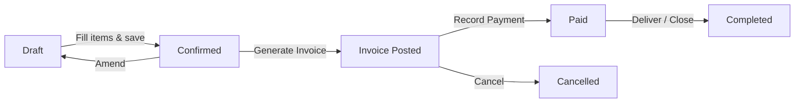

# GII GeM ERP — Quick Start Guide

## 1. Overview

**GII GeM ERP** is a single-user desktop ERP built with **Electron + React** (frontend) and **SQLite** (local database). It manages the supply chain lifecycle for GeM (Government e-Marketplace) portal operations — from master records and purchase orders to invoicing, payments, and financial reporting.

---

## 2. Prerequisites & Installation

| Requirement | Detail |
|-------------|--------|
| Node.js | v18.x or later |
| npm | 9.x+ (ships with Node) |
| OS | Windows 10+ / macOS 12+ / Ubuntu 22+ |

```bash
# 1. Clone or unzip the application bundle
cd gii-gem-erp

# 2. Install dependencies
npm install

# 3. Build the production bundle
npm run build

# 4. Launch the application
npm start
```

> **Note:** The first build compiles native modules (`better-sqlite3`). Ensure your system has build tools installed (see Troubleshooting Guide if this fails).

---

## 3. First Launch

No login screen — the app opens directly to the **Dashboard**.

1. Navigate to **Settings > Company Info**.
2. Fill in your company name, GSTIN, PAN, address, and bank details.
3. Click **Save**. This data populates invoices and reports.

---

## 4. Create Master Records

### Items (Products / Services)

| Field | Description |
|-------|-------------|
| Name | Product / service name |
| HSN / SAC | 6–8 digit code |
| GST Rate | 0%, 5%, 12%, 18%, 28% |
| Unit | Nos, Kg, Meter, etc. |

**Settings > Masters > Items > New**

### Employees

**Settings > Masters > Employees > New** — Enter name, designation, contact.

### Departments

**Settings > Masters > Departments > New** — Used for client / consignee details.

### Suppliers

| Field | Description |
|-------|-------------|
| GSTIN | 15-character GST registration |
| Bank Account | Account number + IFSC |
| Address | Registered office address |

**Settings > Masters > Suppliers > New**

### Warehouses

**Settings > Masters > Warehouses > New** — Name, location, contact person.

---

## 5. Create Supply Order

1. **Operations > Supply Orders > New**
2. Select supplier, department, and warehouse.
3. Add line items — pick item, enter quantity and rate.
4. System auto-calculates subtotal, GST, and grand total.
5. Click **Save** (status: *Draft*).
6. Click **Post** to lock the order (status: *Confirmed*).

> A confirmed supply order is required before generating an invoice.

---

## 6. Generate Invoice

1. Open a **Confirmed** supply order.
2. Click **Generate Invoice**.
3. Fill billing / shipping address (pre-filled from department).
4. Verify line items — GST is auto-calculated per item HSN.
5. Click **Save and Post**.
6. Invoice appears in **Operations > Invoices** with a unique invoice number.

---

## 7. Record Payment

1. **Operations > Payments > New**
2. Select the related invoice.
3. Enter:
   - **UTR / Transaction reference**
   - **Bank name** and date
   - **TDS amount** (if applicable)
4. Click **Save**. Payment status updates on the linked invoice.

---

## 8. Dashboard & Reports

| Report | Location |
|--------|----------|
| Home Dashboard | Default landing — widgets for pending orders, recent invoices, quick stats |
| Profit & Loss | Reports > P&L |
| Balance Sheet | Reports > Balance Sheet |
| GST Register | Reports > GST Register (month-wise input/output summary) |
| Stock Summary | Reports > Stock |

---

## 9. Database Backup

1. **Settings > Backup**
2. Click **Create Backup**. A `.db` file is saved to the configured backup directory.
3. To restore: **Settings > Backup > Restore** and select a backup file.

> Automate backups via the `--backup-schedule` CLI flag (see `--help`).

---

## 10. Keyboard Shortcuts

| Shortcut | Action |
|----------|--------|
| `Ctrl+N` | New record (context-dependent) |
| `Ctrl+S` | Save current form |
| `F5` | Refresh list / dashboard |
| `F1` | Open help / about |
| `Ctrl+F` | Search / filter list |
| `Ctrl+P` | Print current document |
| `Esc` | Close modal / cancel |
| `Ctrl+Shift+B` | Create backup |

---

## Appendix: Supply Order Lifecycle



- **Draft** — Editable, not yet posted.
- **Confirmed** — Locked, invoice can be generated.
- **Invoice Posted** — Financial document created.
- **Paid** — Payment received and recorded.
- **Completed** — Order fulfilled.
- **Cancelled** — Order voided after invoicing.
